# Calm Modern UI (ccu)

[Română](README.ro.md) · English

[](https://hacs.xyz) [](https://github.com/AdrianTIonut/ha-calm-modern-ui/releases)  [](https://github.com/AdrianTIonut/ha-calm-modern-ui/actions) 

A set of custom cards for [Home Assistant](https://www.home-assistant.io/) in a calm, modern style: glassy tiles, green for “active”, blue for information,
orange for attention. **One JavaScript file** (`ccu.js`), no external libraries, no network access, no telemetry.

Every card can be configured **from the Home Assistant UI** (no YAML needed), speaks **English and Romanian**, and works on phone, tablet and wall panels.

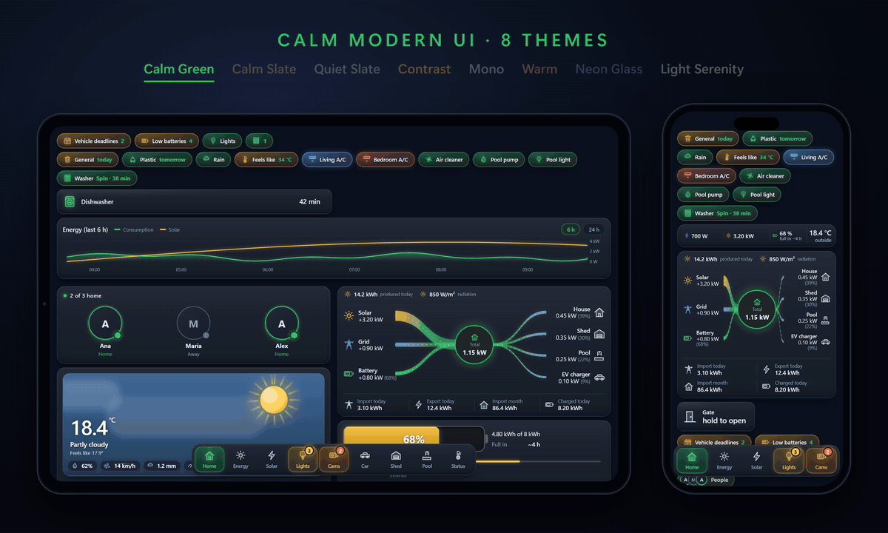

| Card | What it does |
|---|---|
| `ccu-buttons-card` | Grid of tiles (xs–xl): pills, horizontal tiles, switch rows, a “hero” tile with delta and sparkline, alert groups |
| `ccu-chips-card` | Status chips that can show only when active (A/C, rain, pumps…), text states, waste-collection calendar, low batteries and vehicle deadlines |
| `ccu-controls-card` | Thermostat / A/C dial, lights with brightness · colour temperature · quick colours, fan, media player, number, select |
| `ccu-radio-card` | Radio / music player with a tuning dial, equaliser display, station switching, volume and speaker selection |
| `ccu-remote-card` | TV remote (`remote.send_command`) with D-pad, volume, channels and custom keys |
| `ccu-flow-card` | Energy flow: solar / grid / battery → consumers, with percentages, sums, subtractions, statistics, the energy produced today and the solar radiation; animated dots on the ribbons |
| `ccu-battery-card` | Battery bar with thresholds, runtime estimate, “Full in” while charging and a “backup active” state |
| `ccu-batteries-card` | Battery levels of phones, tablets, cars… sorted, with a bar; it can find them automatically |
| `ccu-graph-card` | History graph (6 h … 30 d), 1–3 series, value on touch, optional tap action |
| `ccu-weather-card` | Values from *your* weather station, daily forecast and an animated scene (rain, snow, sleet, wind, storm, fog) |
| `ccu-people-card` | Who is home, as chips or large “family” avatars |
| `ccu-vehicle-card` | Vehicle documents and service: insurance, inspection, road tax, service and oil by kilometres, with editable dates and alerts |
| `ccu-header-card` | One-line header: icon, up to 3 values (with the battery runtime under the percentage), clock or an outdoor value |
| `ccu-nav-card` | Bottom navigation for tablet and phone: different pages and buttons per device, long press, badges, conditional buttons, sticky |
| `ccu-title-card` | Section title with icon and subtitle |

## What’s new in 0.10.0

- **Two new themes:** `quiet-slate` (calm, contrast-tested, no glow) and `cyberpunk` (Neon Glass: very dark indigo, glass, cyan / magenta / amber / coral). There are now 8 themes.
- **New options on any card** (all off by default, with a visual-editor field): `scale` and `radius` (size and rounding), `glow`, `night` (night mode by the sun), `font` and `font_css`, `effects` (`rim`, `mark`, `cut`, `streak`, `peak`, `plot`, `bar`, `tile`).
- **Buttons, chips and menu:** choose what is shown (`show_icon`, `show_name`, `show_value`, `show_state`, `labels`), `selected: true` on a button, danger separate from attention (`danger`, `danger_above`, `danger_below`, `badge_style: danger`).
- **The Solar wave** (`wave: true` on an `xl` button) follows today’s production: the curve, the peak and the glow come from the entity’s history.
- **Graph:** `icon`, `x_step` (round hours every 3) and `axis_unit: false`; series from an attribute; the temperature axis no longer starts at 0.
- **Fonts shipped** in the `fonts/` folder (Exo 2, Chakra Petch, Oxanium); download `fonts.zip` from the latest release and unzip it once into `/config/www/ccu/` (so the files are in `/config/www/ccu/fonts/`).
- **Battery:** the capacity is chosen in the editor (`capacity_source`); “full in” and the autonomy show minutes under an hour.
- Existing cards do not change without the new options. The full list, with explanations, is in [CHANGELOG.md](CHANGELOG.md).

## Gallery

<table>
<tr><td valign="top"></td><td valign="top">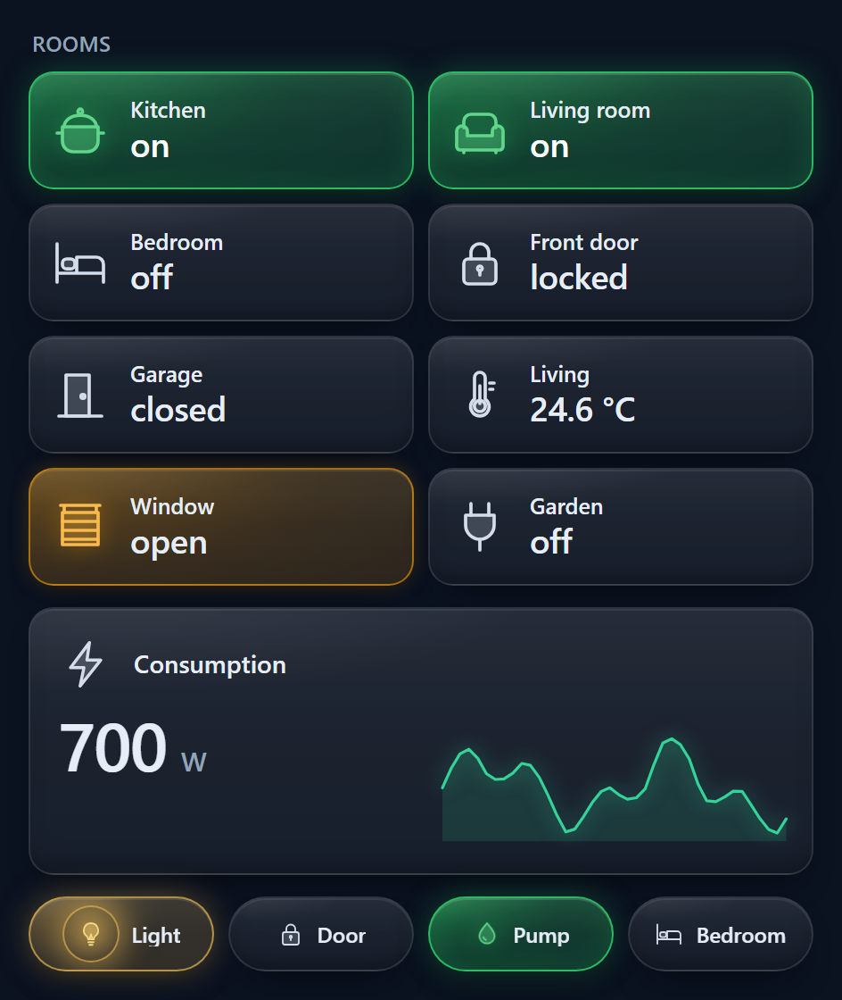</td></tr>
<tr><td valign="top">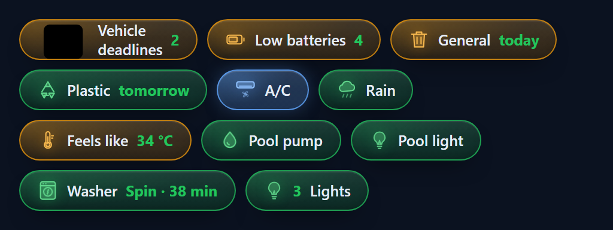</td><td valign="top"></td></tr>
<tr><td valign="top">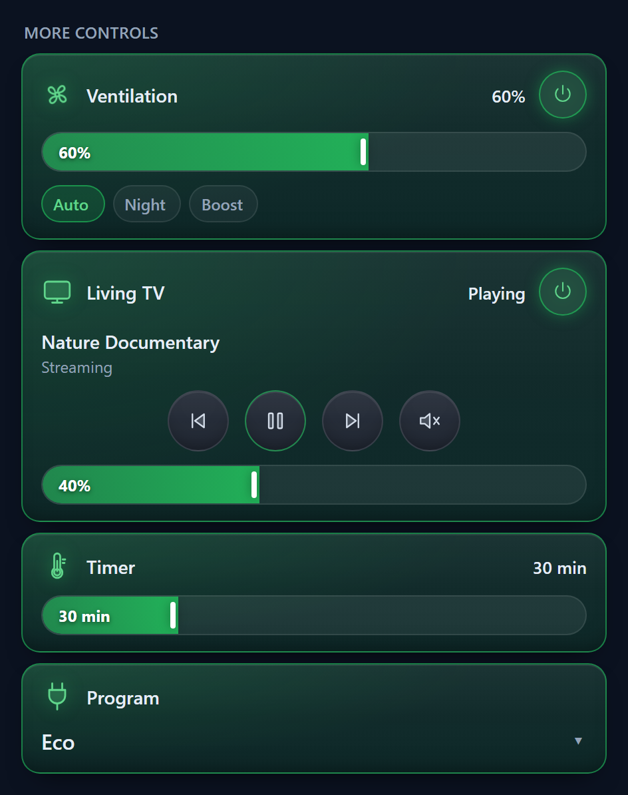</td><td valign="top"></td></tr>
<tr><td valign="top"></td><td valign="top">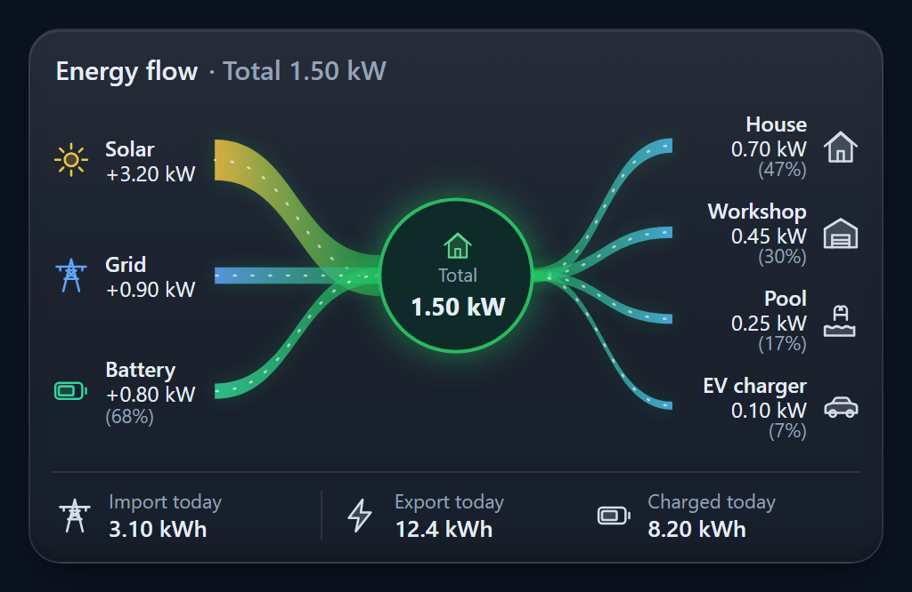</td></tr>
<tr><td valign="top"></td><td valign="top">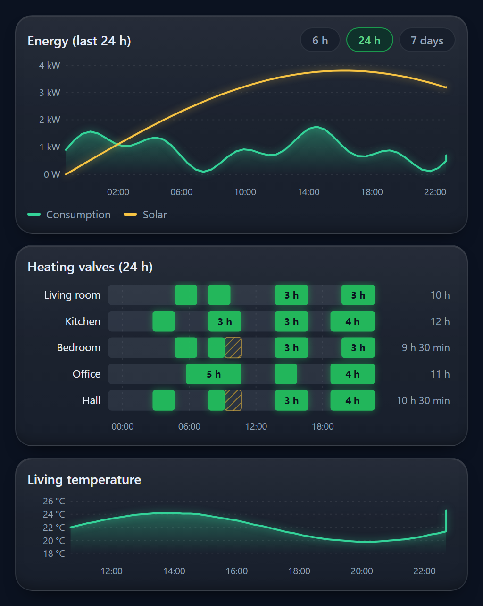</td></tr>
<tr><td valign="top">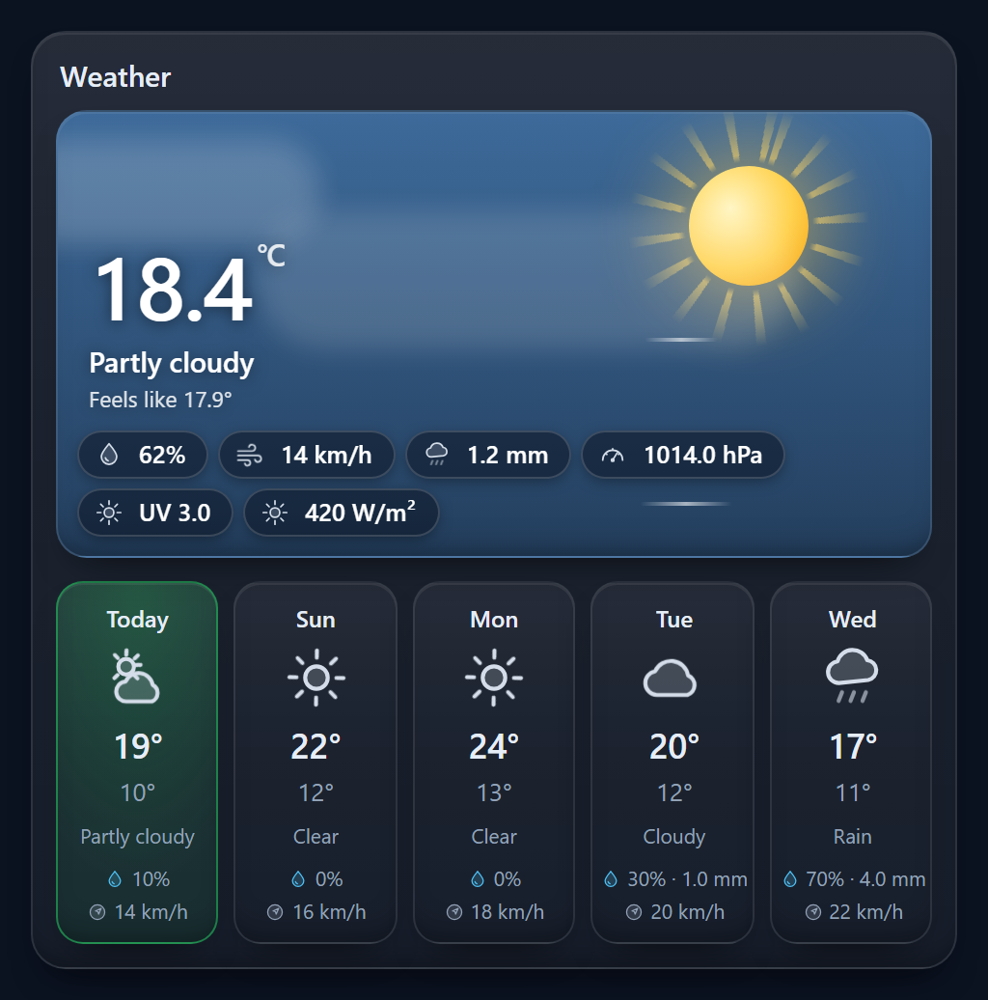</td><td valign="top">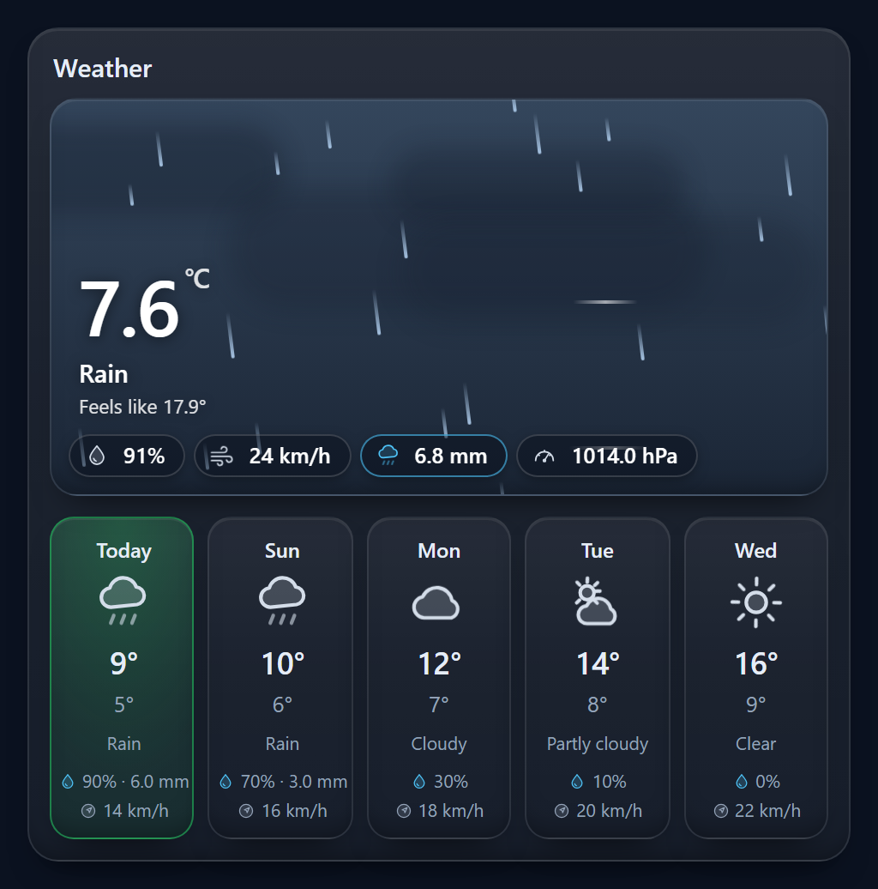</td></tr>
<tr><td valign="top"></td><td valign="top"></td></tr>


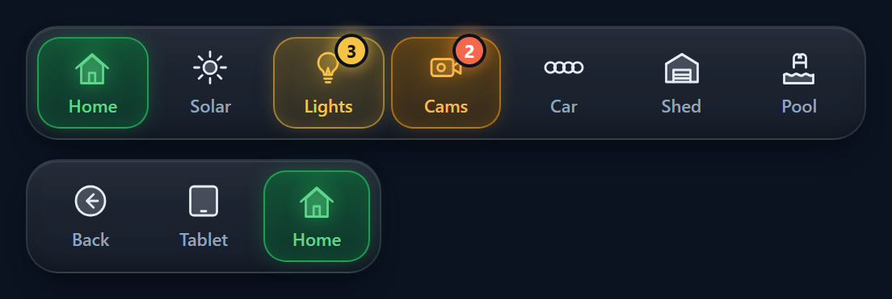
<tr><td valign="top"></td><td valign="top"></td></tr>
</table>

## Example dashboard

A complete dashboard you can paste into Home Assistant: a **tablet** page and a **phone** page, with the same bottom bar on every page (Home goes to the page of the device you hold, a long press jumps to the other one; a phone shows 5 buttons, a tablet shows all 9). Every entity and name in it is invented: replace them with yours. File: [`examples/dashboard-calm.yaml`](examples/dashboard-calm.yaml) (how to use it is in the first lines of the file).

<table>
<tr><td valign="top"></td><td valign="top"></td></tr>
</table>

## Animated icons

The icons move only when it makes sense. **Devices** move only while they are on: the fan of an A/C turns while it is actually cooling, a washer drum turns, a bulb glows, a heater flickers, a charging bolt, a pump or a speaker pulses, the sun glows. The **weather icons** (sun, moon, clouds, rain, snow, sleet, hail, storm, fog, wind) always move. Animations stop on “reduce motion” (or with `animations: false`), and `motion: calm` keeps them short (see below).


### Motion and battery


Continuous animations keep the screen busy, which costs battery on a phone. Every card has a `motion` option (also in the visual editor, under *Look and language*):

| `motion` | What happens |
|---|---|
| `auto` (default) | tablet and PC: `full`; phone (the short side of the screen is under 600 px): `calm` |
| `full` | animations run continuously, as before |
| `calm` | the same animations, but only a few cycles (about 6–10 s) after each change of state, then still until the next change or refresh. Rain, snow, wind and lightning in the weather card are hidden |
| `off` | nothing moves |

```yaml
motion: full            # e.g. keep full motion on your phone as well
weather_effects: off    # weather card: auto | on | off (rain, snow, clouds)
flow_animation: auto    # flow card: auto | on | off (the moving dots on the ribbons)
```

`weather_effects` and `flow_animation` follow `motion` unless you set them. `animations: false` still turns everything off. “Reduce motion” in the system settings is respected as before.

## Installation

**Requirements:** Home Assistant with custom dashboard resources (any current version); developed and tested on Home Assistant 2026.11. One JavaScript file, no dependencies, no network access. The [example dashboard](#example-dashboard) uses the *Sections* view.

### HACS (recommended)

1. In HACS, search for **Calm Modern UI** and download it.
2. Reload the browser (Ctrl+F5, or “force refresh” in the mobile app).

HACS adds the resource for you. (Newer versions of Home Assistant call it *Marketplace*: Settings → Marketplace.)

Not listed yet in your HACS (new additions can take a few days to show up)? Add it by hand: HACS → ⋮ → **Custom repositories** → `https://github.com/adriantionut/ha-calm-modern-ui`, category **Dashboard**.

### Manual

1. Download `ccu.js` from the [latest release](https://github.com/adriantionut/ha-calm-modern-ui/releases/latest) and copy it to `config/www/ccu/ccu.js`.
2. **Settings → Dashboards → ⋮ → Resources → Add resource**: URL `/local/ccu/ccu.js?v=1`, type **JavaScript module**.
3. After each update change the number in `?v=` (otherwise the browser keeps the old file) and force-refresh.

### Updating

- **HACS / Marketplace:** update **Calm Modern UI**, then reload the browser. In the mobile app: Settings → Companion app → Debugging → *Reset frontend cache* (or close the app completely and open it again), otherwise the app keeps the old file.
- **Manual:** replace `config/www/ccu/ccu.js` and change the number in `?v=` in the resource.

### Try it

Add a card and pick **Calm Modern — Title**, or paste:

```yaml
type: custom:ccu-title-card
title: It works
subtitle: Calm Modern UI
```

## Visual editor (no YAML)

**Add card → Calm Modern — …** opens a form with entity and icon pickers, lists with ↑ ↓ ✕ buttons and a live preview. YAML stays available
(“Show code editor”); options the form does not cover (thresholds, `show_if`, `text_map`, `on_states`, …) are kept untouched when you save.

- **Energy flow**: the *Auto-detect sensors* button looks for solar, grid and battery power sensors by unit (W / kW) and name. Tick only what you have: Solar, Grid, Battery.
- Every card has a *Look and language* block (theme, language).
- Tap / hold / double-tap actions are picked from the Home Assistant action selector.

## Themes and colours

Eight built-in themes (`green` is the default; `quiet-slate` is the calm one, contrast-tested and without glow; `cyberpunk` is “Neon Glass”). Any card accepts `preset:` and `colors:`; every color of every theme is listed in [docs/COLORS.md](docs/COLORS.md).

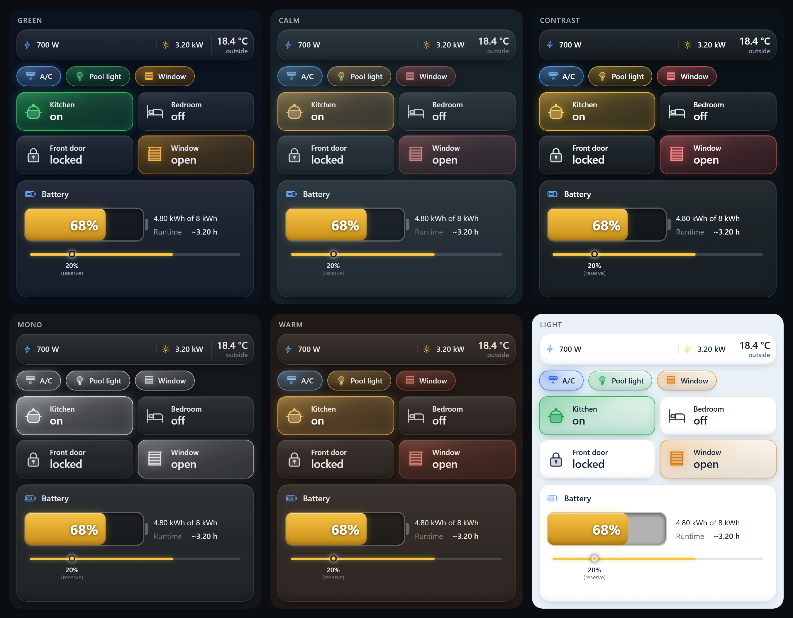


Override any role on a single card (or all of them):


```yaml
preset: green        # default. Others: calm, quiet-slate, contrast, mono, warm, light
colors:              # optional, overrides any colour
  on: '#22c55e'      # active
  alert: '#f59e0b'   # attention
  accent: '#3b82f6'  # information
  cool: '#60a5fa'    # A/C cooling
  heat: '#f4694b'    # A/C heating
  series: '#34d399'  # graph line
  bg: '#0b1220'      # background
animations: false    # turns every animation off (they also stop on “reduce motion”)
language: en         # optional; default is the Home Assistant profile language
```

Only valid colours are accepted (`#hex`, `rgb()`, `hsl()`, `var(--…)`); anything else is ignored with a warning on the card.
YAML tip: an unquoted `on` becomes `true`; the cards treat it as “on”, but quoting (`"on"`) is the safe form elsewhere.

### Size and corner radius (on every card)

```yaml
scale: 1.25     # 0.7–1.6; default 1. Makes the whole card bigger / smaller, proportionally (text, icons, buttons)
radius: 8       # 0–32 px; default 14. Corner radius (0 = square corners)
```

- **`scale`** is for different screens (a wall tablet, a phone, a screen seen from afar, weaker eyesight). When you enlarge, fewer columns fit, so the grid re-flows by itself. The range is 0.7–1.6; outside it the value is clamped, with a warning on the card.
- **`radius`** applies to buttons with the `chamfer` and `square` shapes, panels and the header (panels get ~1.3× the radius). The `round` and `pill` shapes stay round.
- Both are in the visual editor, under “Appearance and language”. Without them the cards look exactly as before.

### Glow and luminous wave

```yaml
glow: soft      # auto (default, as the theme) | off | soft | full — on every card
wave: true      # luminous wave on big cards (size: xl); on the card or on each entity
```

- **`glow`** sets how much the “on” / “attention” states, bulbs and the wave glow. `auto` keeps exactly what the theme defines (the older themes glow as before; `quiet-slate` does not). `off` = none, `soft` = half, `full` = maximum.
- **`wave`** draws a thin wave with a discreet halo under the value, on `xl` buttons only. The line shows even with `glow: off`; the halo follows `glow`. It moves slowly (“breathes”) and stops with `animations: false` or on “reduce motion”.
- Lit bulbs use the theme’s `lamp` / `lamp-hi` colors (a discreet amber in `quiet-slate`, the usual yellow elsewhere); change them with `colors: { lamp: '#e0bd86' }`.
- Both have fields in the visual editor (“Appearance and language” and “What the button shows”). Without them the cards look exactly as before.

### Night mode

```yaml
night: auto          # off (default) | auto — dims the card when the sun is below the horizon (sun.sun)
night_dim: 20        # 0–60 %, how much it dims; default 15
night_entity: binary_sensor.dark   # optional: another entity instead of sun.sun
```

- Without `night` nothing changes. With `night: auto` the card becomes a little less bright at night (so a wall tablet does not glare) and returns by itself in the day.
- For another entity, “on”, “night” or “below_horizon” means night. If the entity is missing the card stays as in the day.
- It is in the visual editor, under “Appearance and language”.

### Danger (red), separate from attention

```yaml
entities:
  - entity: sensor.boiler
    alert_above: 30        # attention (amber in quiet-slate)
    danger_above: 35       # danger (red); likewise danger_below
  - entity: binary_sensor.smoke
    on_as: alert
    danger: true           # this entity's alert shows as danger
```

- On buttons and chips. Without these keys nothing changes: an alert stays “attention”, as before.
- `danger_above` / `danger_below` turn the entity into a danger alert (zero is a valid threshold). `danger: true` makes the alert the entity already had red.
- In the bottom menu: `badge_style: danger` makes the whole item red while the badge count is above 0.
- The color comes from the theme (`danger`, the old red by default; a pastel red in `quiet-slate`) and can be changed with `colors: { danger: '#e88f8a' }`. In themes where “attention” is already red (e.g. `calm`) danger just looks stronger.
- Fields in the visual editor, on each button and chip.

### What chips and the bottom menu show

```yaml
# ccu-chips-card
show_icon: true     # false = no icon (on the card or on each chip)
show_name: true     # false = only the icon / value; the name stays as the aria-label
# ccu-nav-card
show_icon: true     # false = text only
labels: true        # false = icons only
items:
  - { icon: home, label: Home, path: /a, show_label: false }   # per-item override (and show_icon)
```

- If a chip or button would be left empty (no icon, name or value), the icon stays. The menu badge stays visible even without the icon.
- Without these keys nothing changes. Visual-editor fields, on the card and on each chip / button.

### The `cyberpunk` theme (Neon Glass), fonts and effects

```yaml
preset: cyberpunk          # very dark indigo, glass, cyan = on, magenta = selected, amber = attention, coral = danger
font: Exo 2                # Exo 2 | Chakra Petch | Oxanium (shipped), or the name of your own font + font_css
effects: [rim, mark]       # rim | mark | cut | streak | peak | plot | bar | tile | none; empty = as the chosen theme
```

- **Effects** (all optional, off in the older themes): `rim` = neon outline lit from the top-left; `mark` = the “//” mark on lit and big cards; `cut` = cut corners on big cards, panels, the header and the bottom menu; `streak` = a light streak along the top edge of active cards; `peak` = a diamond at the wave peak and a white dot at the graph maximum; `plot` = a graph with vertical dashed lines (no horizontal ones) and the left axis; `bar` = the header (label above the value, white icons, clock with an icon) and the bottom menu (icon beside the text, separators, the current item = a glowing pill). `tile` = the “Neon Smart Home UI” style: on tiles icon | separator | name and state, the big value centred below, “//” on all of them, and on the Solar card title and subtitle on one line and a star at the wave peak. `cut` corners are 9 px and the border follows the diagonal (the header and menu use 7 px; the lit row has only its top-left and bottom-right corners cut). The `cyberpunk` theme turns on only the style effects (`rim`, `mark`, `cut`, `streak`, `peak`, `plot`); the format (sizes, layout) stays as in the other themes, so the menu and header fit on a phone. `bar` and `tile` change the layout (menu in a row, tile with a separator) and are added only with `effects:`; `effects:` lets you choose.
- **Fonts** are in the repository’s `fonts/` folder (Exo 2, Chakra Petch, Oxanium, all SIL Open Font License; they include the letters ă â î ș ț). Download `fonts.zip` from the [latest release](https://github.com/AdrianTIonut/ha-calm-modern-ui/releases/latest) and unzip it into `/config/www/ccu/`, so the files end up in `/config/www/ccu/fonts/` (HACS / Marketplace installs only `ccu.js`, never the fonts; this step is needed even then). Manual installs can copy the repository’s `fonts/` folder instead. The browser then caches them: nothing is downloaded every time and nothing is requested from the internet. Without the files the text uses Inter / the system font.
- **Your own font:** put the `.woff2` files and a stylesheet with `@font-face` in `/config/www/ccu/fonts/` and write `font: My Font` and `font_css: /local/ccu/fonts/my-sheet.css`. Only addresses starting with `/` or `https://` are accepted.
- The graph also has `icon:` (an icon in the title, with a separator in the `tile` style), `x_step: 3` (labels `00 03 06 …` every 3 hours, for ranges up to 48 h) and `axis_unit: false` (no unit on the Y axis: `2.0` instead of `2 kW`), a good match for `plot`.
- **The wave (`wave: true`) follows today’s production:** the curve is drawn from the entity’s history, from the start of today’s production until now, with the peak (diamond / star, the `peak` effect) at the real maximum of the day. The glow grows with the current power relative to the day’s maximum; with no production today it stays a flat, dim line, and after sunset the day’s curve stays but dim. Without history (e.g. in the visual editor) the decorative shape is shown.
- On a button: `selected: true` shows it as “selected” (magenta in `cyberpunk`). `danger` alerts read “Alert”.
- Visual-editor fields: “Font” and “Effects” under “Appearance and language”, “Highlighted (selected)” on each button.

## Actions

Every entity accepts `tap_action`, `hold_action` (500 ms) and `double_tap_action` (300 ms window):

```yaml
- entity: light.living
  tap_action: toggle              # toggle | more-info | navigate | call-service | url | none
  hold_action: { action: more-info }
  double_tap_action:
    action: call-service          # the UI editor’s `perform-action` works too
    service: light.turn_on
    service_data: { brightness_pct: 100 }
    target: { entity_id: light.living }
```

Default: lights, plugs, locks, covers and scenes → `toggle`; everything else → `more-info`.
Lights, plugs and fans are switched with `turn_on` / `turn_off` (many relays do not implement `toggle`).
`navigate` needs a full path (`/dashboard-home/rooms`); `url` accepts only `http:` / `https:`. Scrolling or moving more than 10 px cancels the gesture.

## Cards

### ccu-buttons-card


```yaml
type: custom:ccu-buttons-card
columns: 2            # 1–6 (narrow screens)
columns_wide: 3       # columns when the card is wide (≥ 420 px)
density: m            # xs | s | m | l | xl (default size)
panel: false          # true = panel with border and title
title: Rooms          # optional
entities:
  - light.kitchen                        # short form
  - entity: sensor.lab
    name: Lab
    icon: mdi:flask                      # any icon of the Home Assistant picker works (mdi:…); the card draws its own for the common ones
    icon_color: yellow                   # green|yellow|orange|blue|cyan|red|white
    size: m
    shape: chamfer                       # chamfer | round | pill | square
    alert_above: 30                      # numeric sensor: above the threshold = attention
    secondary: { entity: sensor.lab_temp }   # secondary text: text | {attribute} | {entity} | false
```

Sizes: **xs** pill · **s** vertical · **m** horizontal tile · **l** wide row (`toggle: true` = switch) ·
**xl** hero: big value, `delta: { entity, percent_entity }`, `spark: { hours: 6 }`, `active: true`.
Powers in W from 1000 up are shown as kW (`auto_kw: false` keeps W).

### What a button shows

Each button can show an **icon, a name, a state line and a value**. Set them on the card (for all buttons) and override them on any single button. Everything is also in the visual editor (the “What the button shows” section; on a button, the “Choose what this button shows” switch).

```yaml
type: custom:ccu-buttons-card
show_icon: true        # default true
show_name: true        # default true
show_value: true       # default true (the value / secondary text)
show_state: true       # default false: the “● On” / “○ Off” line
state_style: dot       # dot = dot + text (default) | text = text only
state_labels:          # optional: other texts for the states (for example in another language)
  on: Aprins
  off: Stins
  alert: Atenție
  unavailable: Indisponibil
entities:
  - entity: light.kitchen
    secondary: { entity: sensor.kitchen_temperature }   # “24.6 °C” under the “On” state
  - entity: sensor.lab
    show_state: false  # on a button, overrides the card
```

- With `show_state: true` a button has three lines: **name / state / value**. If you hide a line the button re-lays out (two lines are left) and never drops below the minimum touch size.
- Numeric sensors (`sensor`, `number`…) are not “on / off”: for them the state line only appears for *Attention*, *OK* and *Unavailable*.
- When you hide the name or the value, screen readers still get them (`aria-label`: name, state, value).
- Without these options the buttons look exactly as before.

Groups and alerts (also on chips):

```yaml
- entity: binary_sensor.cam1_person          # base entity (required)
  name: 📹 CAMERAS
  group: [binary_sensor.cam1_person, binary_sensor.cam2_person]   # lights up when ANY is “on”
  group_text: People on {n} cameras
  group_idle: No activity
```

### ccu-chips-card


```yaml
type: custom:ccu-chips-card
entities:
  - { entity: climate.ac_living, name: A/C, icon: mdi:air-conditioner, hide_off: true }   # shows only when on; if no chip is visible the whole card disappears
  - { entity: sensor.feels_like, name: Feels like, show_state: true, alert_above: 32, hide_off: true }
  - entity: sensor.washer_status
    name: Washer
    hide_off: true
    show_state: true
    on_states: [running, spinning, rinsing]               # which text states mean “active”
    text_map: { spinning: Spin, running: Wash }           # translate the shown state
    secondary: { entity: sensor.washer_remaining_time }   # a timestamp sensor shows “38 min” / “done”
  - { entity: group.all_lights, icon: mdi:lightbulb, count: true, hide_off: true }        # number of members that are on
waste:                                                    # chips from a waste-collection calendar
  calendar: calendar.waste
  next_days: 1
  hide_today_after: '11:00'
  patterns:
    - { match: 'Waste: General', label: General, icon: mdi:trash-can, exact: true }
```

**One row, in order of activation.** All chips of a card (entities, waste, low batteries, deadlines) flow in one row and continue on the next row only when they no longer fit. Add `sort: true` (checkbox *Sort by activation time* in the editor) to order them by the moment they became active (`last_changed`), oldest first. A chip that turns on later goes to the end, so the others do not jump around. For one single line on a tablet, put the card on the full width of the view (`grid_options: { columns: full }`) and keep all chips in **one** card.

```yaml
type: custom:ccu-chips-card
sort: true
```

**Inactive chips in the editor.** While you edit the card (card editor or dashboard edit mode), the chips that are hidden right now (`hide_off`, `show_if`) are shown faded with a dashed border, so you can see everything the card can show. On the dashboard itself they stay hidden.

A **low batteries** chip that finds the devices on batteries by itself (battery sensors; phones and tablets are left out):

```yaml
type: custom:ccu-chips-card
low_batteries:
  threshold: 20                 # low = up to this percentage (default 20)
  exclude: [inverter, car]      # words in the name / entity_id to leave out
  tap_action: { action: navigate, navigation_path: /dashboard-home/batteries }   # default: more-info of the lowest one
```

It shows only when something is low: the count (“Low batteries 3”) or, with a single one, its name and level.


### ccu-controls-card


```yaml
type: custom:ccu-controls-card
title: Climate          # optional
columns: 1              # 1–3
items:
  - { entity: climate.living_ac, name: Living A/C }   # dial: big target, +/−, modes, fan / swing / preset; style: simple = compact
  - { entity: light.strip_rgb, name: Strip }          # round on/off + brightness slider, colour temperature, quick colours; an on/off-only bulb becomes a simple tile
  - { entity: fan.ventilation, labels: { night: Night } }
  - { entity: media_player.tv }                        # title, transport, mute, volume
  - { entity: number.timer, name: Timer }              # slider with min / max / step from the entity
  - { entity: select.program, name: Program }
```

### ccu-radio-card


```yaml
type: custom:ccu-radio-card
title: Pool radio
stations: input_select.radio_favorite       # options like "Name - https://stream.url" (the URL part is hidden)
player: media_player.pool_speaker           # main speaker: volume + availability
speakers:                                   # optional: several speakers, with buttons to choose where it plays
  - media_player.pool_speaker
  - media_player.living_speaker
playing: input_boolean.radio_playing        # optional
play: script.radio_play                     # optional: your scripts; without them the card sends the stream URL to the chosen speaker
stop: script.radio_stop
hide: [Custom]                              # hide stations containing these words
```

### ccu-vehicle-card


Insurance, inspection, road tax and service deadlines per vehicle: days left, a bar that turns orange `alert_days` before and red after the date, and dates you change from the card itself.

```yaml
type: custom:ccu-vehicle-card
alert_days: 3                   # orange (and in the chip) this many days before
vehicles:
  - name: Family car
    plate: AB 12 XYZ            # optional
    icon: mdi:car
    documents:
      - { label: Insurance, entity: input_datetime.car_insurance }       # a date helper: tap the row to pick a new date
      - { label: Service, entity: sensor.car_service_date }               # a sensor with a date: read-only
      - label: Oil
        odometer: sensor.car_odometer
        last_km: input_number.car_oil_km                                   # odometer at the last change; the "Changed now" button sets it
        interval_km: 10000                                                 # or: remaining: sensor.km_until_oil
```

Chip for chips-card (a chip only while something is close or expired; the single deadline or the count):

```yaml
type: custom:ccu-chips-card
deadlines:
  alert_days: 3
  vehicles: [...]               # same format as above
  tap_action: { action: navigate, navigation_path: /dashboard-home/vehicles }
```

### ccu-remote-card


```yaml
type: custom:ccu-remote-card
entity: remote.living_room_tv        # remote.send_command
dpad: true
commands: { power: KEY_POWER, volu: KEY_VOLUP }       # rename commands for another TV model
rows: [[power, mute], [vold, volu, chd, chu]]         # keys and order: power mute vold volu chd chu home back menu input
extra:
  - { label: Netflix, icon: play, command: KEY_11 }   # custom keys
```

### ccu-flow-card

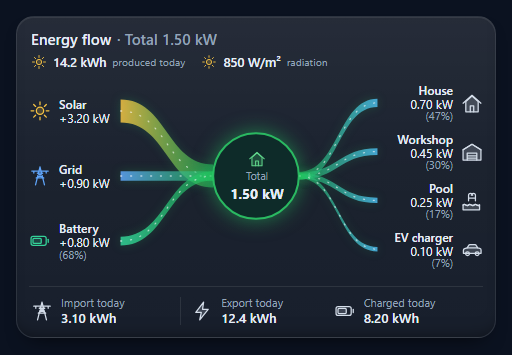

```yaml
type: custom:ccu-flow-card
title: Energy flow
solar: sensor.solar_power
solar_today: sensor.solar_energy_today        # optional: energy produced today, a small row under the title (sun icon)
radiation: sensor.solar_radiation             # optional: solar radiation (W/m²) in the same row
sun_labels: false                             # optional: hide the words next to those two values (shown by default)
grid:    { entity: sensor.meter_active_power, invert: true }   # convention: + = import; invert if your sensor is + on export
battery: { entity: sensor.battery_power, soc: sensor.battery_soc }   # + = discharging
consumers:                  # up to 6; the percentage is of Total (sum of consumers)
  - { entity: sensor.house_power, subtract: [sensor.pool_power], name: House, icon: mdi:home }   # value minus other entities (min 0)
  - { entities: [sensor.shed_a, sensor.shed_b, sensor.shed_c], name: Shed, icon: mdi:warehouse }   # sum of several entities (e.g. 3 phases)
stats:                      # up to 4, bottom row
  - { entity: sensor.grid_import_today, label: Import today, icon: mdi:transmission-tower }
```

Shown signs: grid — export “+”, import “−”; battery — charging “+”, discharging “−”. A source with no exchange (solar at night, battery idle, grid ~0) draws no ribbon.
`hide_idle: false` keeps a consumer under 10 W visible.
The dots flow along the ribbons in the direction of the energy (towards the node, or towards a consumer). `flow_animation: off` stops them, and `motion: calm` lets them run for a few seconds only.

### ccu-battery-card · ccu-batteries-card


```yaml
type: custom:ccu-battery-card
soc: sensor.battery_soc
capacity_source: ah                           # where the capacity comes from: kwh | entity | ah (see “Battery capacity” below)
capacity_ah_entity: number.battery_capacity_ah  # Ah, read from the inverter (or capacity_ah: 942)
nominal_voltage: 51.2                         # V, for the Ah × V calculation
load: sensor.load_power                       # for the runtime estimate
load_entities: [sensor.other_load]            # optional: more loads on the battery, added to `load`
power: sensor.battery_power                   # optional: + = discharging, − = charging (power_invert: true flips it)
charge_eta: avg                               # “Full in” from: avg (average of the last 10 min, default) | now
runtime_while_charging: false                 # true = show the runtime while charging too
grid_present: binary_sensor.grid              # off = “Backup active”
reserve_pct: 20
shutdown_pct: 10
```

#### Battery capacity: what to enter

The card turns the percentage into kWh with **one number: the energy of the whole battery at 100 %** (the nominal capacity). It is **not** the energy left after the shutdown or reserve levels: the card subtracts those itself. In the editor, *Battery capacity comes from* offers three sources, and only the fields of the chosen one are shown:

| Source (`capacity_source`) | You give | Use it when |
|---|---|---|
| **A value I type** (`kwh`) | `capacity_kwh: 48.2` | simplest and safest; the nominal kWh of the battery |
| **Sensor in kWh** (`entity`) | `capacity_entity: sensor.…` | you have a sensor that reports the nominal kWh |
| **Ah × nominal voltage** (`ah`) | `capacity_ah_entity` (a sensor or number in Ah) or `capacity_ah`, and `nominal_voltage` (default 51.2 V) | the inverter reports Ah, e.g. Deye: 942 Ah × 51.2 V = **48.2 kWh** |

- With a chosen source the card uses **only** that source. If its value is missing (for example the sensor is `unavailable`) it shows “—” instead of silently taking another field. Without `capacity_source` it behaves as before: the sensor if it has a value, otherwise `capacity_kwh`.
- **Do not use “estimate” sensors.** Some integrations publish a “battery capacity” that is a learned estimate (for example the Solarman *Battery Capacity* sensor, which stays near one value and is computed from energy counters). It is not the capacity of the percentage scale and made the card show about 20 % too little energy.
- **Check it yourself:** over a charge of, say, 30 points of the percentage, the energy that went into the battery divided by 0.30 should be close to the number you entered.
- Example, 48.2 kWh with `reserve_pct: 20` and `shutdown_pct: 10`: with grid the usable band is 80 % × 48.2 = **38.6 kWh** (the 20 % below the reserve are left out, shutdown included); without grid it is 90 % × 48.2 = **43.4 kWh**. The 10 % shutdown and the reserve are levels on the same 0–100 % scale, they are not added.

How the numbers are computed (exactly, from percentages and capacity; rounding only when shown):

- **With grid**: the usable band is `reserve_pct` → 100 %. The card shows the energy in that band, “X kWh of Y kWh”, with Y = (100 − reserve)% × capacity, and the runtime until the reserve at the current load.
- **Without grid (backup active)**: the band becomes `shutdown_pct` → 100 %, the same “X kWh of Y kWh” and the runtime until the shutdown level. Only then the card shows “Backup active” and the shutdown marker.
- **The runtime** is the usable energy divided by the current load (`load` plus `load_entities`, summed), as if the charging stopped now. If any of those sensors has no value, no runtime is shown rather than a too-optimistic one.
- **While charging** (needs `power`) the card shows “Full in”: the time to 100 % at the charging power, taken as the **average of the last 10 minutes** so the number does not jump when a cloud passes (`charge_eta: now` uses the current power instead). The runtime is hidden while charging; `runtime_while_charging: true` shows it as well. Above 99 % “Full in” goes away and the runtime comes back. The same works in the header (`runtime_power`, `runtime_charge_eta`, `runtime_while_charging`).
- **Durations** (“Full in” and the runtime, on the battery card and under the percentage in the header) are shown in **minutes under one hour** (“~42 min”), as **hours and minutes** up to 10 hours, rounded to 5 minutes (“~1 h 25 min”), and with one decimal from 10 hours on (“~16.2 h”).
- Change `reserve_pct` (for example 20 → 30) and everything follows. The big percentage is always the real state of charge.


```yaml
type: custom:ccu-batteries-card
title: Device batteries
warn_pct: 20          # below = orange
low_pct: 10           # below = red
entities:
  - { entity: sensor.tablet_battery_level, name: Tablet }
  - sensor.phone_battery_level
```

`auto` finds every device with a battery sensor (`device_class: battery`) in Home Assistant, without phones, tablets and browsers; `only_low: true` lists just the low ones:

```yaml
type: custom:ccu-batteries-card
title: Devices on batteries
auto: { threshold: 20, exclude: [inverter, car], include: [sensor.some_battery] }
```


### ccu-graph-card


```yaml
type: custom:ccu-graph-card
title: Energy (last 6 h)
range: 6h                 # 6h | 12h | 24h | 7d | 30d, or any 48h / 3d … (1 h – 90 days), or { hours: 36 }
tabs: [24h, 7d]           # optional range tabs
y_axis: right
height: 150               # 60–400
compact: true             # legend in the title row
tap_action: { action: navigate, navigation_path: /dashboard-home/energy }   # optional: tap opens the page of this graph
series:                   # 1–3 series
  - { entity: sensor.consumption, name: Consumption, color: accent, kind: area }
  - { entity: sensor.solar, name: Solar, color: yellow, kind: line }
```

**On / off series** (heating valves, switches, door and window sensors: states `on`, `off`, `open`, `closed`, `home`, `not_home`…) are drawn as a **step chart** with *Off* / *On* on the axis, and the last state holds until now:

```yaml
type: custom:ccu-graph-card
title: Living room valve
range: 48h
series:
  - { entity: binary_sensor.living_room_valve, name: Valve }
```

**Timeline** (`timeline: true`): one row per series with a bar wherever it is on, up to 8 rows in one small card. Made for heating valves, switches, doors and windows:

```yaml
type: custom:ccu-graph-card
title: Heating valves (24 h)
timeline: true
range: 24h
series:                       # up to 8; the name is the row label
  - { entity: binary_sensor.living_room_valve, name: Living room }
  - { entity: binary_sensor.kitchen_valve, name: Kitchen }
  - { entity: binary_sensor.bedroom_valve, name: Bedroom, color: yellow }
```

**An attribute instead of the state** (`attribute`): a series can read a numeric attribute of the entity, for example the temperature of an air conditioner (`climate` entities have the state `off` / `cool` / `heat`, and the temperatures are attributes). Optional `unit` (for temperatures the unit of Home Assistant is used). Checkbox *Read an attribute instead of the state* in the editor.

```yaml
type: custom:ccu-graph-card
title: A/C kitchen, actual vs set (24 h)
series:
  - { entity: climate.ac_kitchen, attribute: current_temperature, name: Actual }
  - { entity: climate.ac_kitchen, attribute: temperature, name: Set, color: yellow }
```

**Active only while the state is…** (`state_is`): the series is “on” while the state is one of the listed values (comma separated or a list). With the timeline this gives one row per mode of a thermostat, with durations and totals. Checkbox *Active only while the state is…* in the editor.

```yaml
type: custom:ccu-graph-card
title: A/C kitchen, mode (24 h)
timeline: true
series:
  - { entity: climate.ac_kitchen, state_is: cool, name: Cooling }
  - { entity: climate.ac_kitchen, state_is: heat, name: Heating, color: yellow }
```

(`attribute` and `state_is` do not go together on the same series. Any entity can be used, not only sensors.)

On the timeline each bar shows **how long it ran** (“3 h”, “1 h 25 min”; narrow bars get a short form or none), the right edge shows the **total per row**, periods when the entity was **unavailable** are **hatched amber**, and the axis uses round hours (00:00, 03:00, …). Touch or hover a bar, a hatched gap or an off period to read the exact interval and duration. `hide_durations: true` removes the durations and the totals (checkbox in the editor).

A series whose entity has no numeric state and no on/off state draws nothing (for example a `climate` entity: its state is the mode, not a temperature). Use its temperature sensor instead.

### ccu-weather-card


Current values come from **your station sensors**, the daily forecast from the `weather.*` entity.

```yaml
type: custom:ccu-weather-card
title: Weather
weather: weather.home
sensors:                              # all optional; a tile shows only if it has a sensor
  temperature: sensor.outdoor_temperature
  humidity: sensor.humidity
  wind_speed: sensor.wind_speed       # km/h, m/s, mph or kn (converted)
  rain_rate: sensor.rain_rate
  pressure: sensor.pressure
  uv: sensor.uv_index
tiles: [humidity, wind, rain, pressure, uv, radiation]
days: 5                               # 1–7
```

### ccu-people-card · ccu-header-card · ccu-nav-card · ccu-title-card


```yaml
type: custom:ccu-people-card
layout: family        # large avatars with name and state
people: [person.ana, person.maria]
```

```yaml
type: custom:ccu-header-card
header:
  icon: home
  values:                       # up to 3
    - { entity: sensor.consumption, icon: bolt, color: accent, label: Load }
  right: { entity: weather.home, attribute: temperature, label: outside }   # replaces the clock
```

The battery percentage can carry its **runtime** as a small text under it (it stays visible on a phone):

```yaml
type: custom:ccu-header-card
header:
  icon: home
  values:
    - entity: sensor.battery_soc
      icon: battery
      color: ok
      runtime_load: sensor.house_load_power      # the load, as on the battery card (+ runtime_load_entities to add more)
      runtime_capacity_kwh: 10                   # or runtime_capacity_entity, or runtime_capacity_ah_entity + runtime_nominal_voltage (with runtime_capacity_source: kwh | entity | ah)
      runtime_reserve_pct: 20
      runtime_power: sensor.battery_power        # optional: while charging it shows “full in …” instead of the runtime
      runtime_charge_eta: avg                    # avg (average of the last 10 min, default) | now
      runtime_while_charging: false              # true = show the runtime while charging as well (second line)
```

In the visual editor this is the *Show the runtime under the value* checkbox on each value.

```yaml
type: custom:ccu-nav-card
sticky: true
compact: true
items:
  - { back: true, icon: back, label: Back }
  - { icon: home, label: Home, path: /dashboard-home/0 }
  - { icon: camera, label: Cams, path: /dashboard-home/cams, badge: [binary_sensor.cam1_person] }

  - { icon: bulb, label: Lights, path: /light, badge: [sensor.lights_on], badge_style: light }   # yellow badge with the number of lights on (a numeric sensor adds its value)
  - { icon: tablet, label: Tablet, path: /dashboard-home/tablet, visible_if: { entity: sensor.browser_user, state: Tablet } }
```

**One bar for tablet and phone.** The same card can be used on every page: `Home` goes to a different page on each device, and some buttons only show on a tablet.

```yaml
type: custom:ccu-nav-card
sticky: true
items:
  - { icon: home,   label: Home,  path_tablet: /dashboard-home/tablet, path_phone: /dashboard-home/phone, hold_path_phone: /dashboard-home/tablet, hold_path_tablet: /dashboard-home/phone }   # a long press jumps to the other device's home
  - { icon: sun,    label: Solar, path: /dashboard-home/solar, match: [/dashboard-home/solar, /dashboard-home/solar-water] }   # lit on every page of the group
  - { icon: bulb,   label: Lights, path: /dashboard-home/lights }
  - { icon: camera, label: Cams,  path: /dashboard-home/cams, match: [/dashboard-home/cams, /dashboard-home/cams-tech] }
  - { icon: car,    label: Car,   path: /dashboard-home/car,  device: tablet }     # only on a tablet; use device: phone for phone-only buttons
```

- `path_tablet` / `path_phone` (or `path: { tablet: …, phone: … }`) set where a button goes on each device. A plain `path` is the default.
- `hold_path` (any device), `hold_path_tablet` and `hold_path_phone` set where a **long press** goes (about half a second): for example Home on a phone can jump to the tablet home page, and the other way round.
- **Placement:** with `sticky: true` the bar is fixed at the bottom of the screen and reserves the room it needs inside the page. Put the card in the **last section** of the view, spanning all columns, so that room is at the end of the page; otherwise the last row of buttons can end up behind the bar.
- A phone is a screen whose short side is under 600 px; everything else (tablet, iPad, PC) is a tablet. `device: phone` or `device: tablet` on the card forces it.
- The button of the page you are on lights up (green), also when it has a badge; `match` lists extra pages that light the same button.

```yaml
type: custom:ccu-title-card
title: Kitchen
subtitle: Climate · lights
icon: pot
```

## Troubleshooting

- **“Custom element doesn't exist: ccu-…”**: the resource is not loaded. Check Settings → Dashboards → ⋮ → Resources (type *JavaScript module*, URL `/local/ccu/ccu.js?v=…`), then force-refresh (Ctrl+F5; in the app: *Reset frontend cache*).
- **A new option does nothing after an update**: the browser or the app still has the old file. Change the `?v=` number in the resource and force-refresh.
- **A card shows “—”**: the entity does not exist or has no value yet. Copy the exact id from Developer tools → States.
- **The battery runtime shows “—”**: it needs the load sensor (`load`, in W or kW). With `load_entities`, every sensor of the list must have a value.
- **“Full in” is missing while charging**: it needs the battery power sensor (`power`: + = discharging, − = charging; `power_invert: true` flips it) and a level under 99 %.
- **The last buttons of a page are hidden by the bottom bar**: put the bar in the last full-width section of the view (see the navigation card).
- **The phone drains faster with the dashboard open**: animations keep the screen busy; `motion: calm` (the phone default) or `motion: off` helps (see *Motion and battery*).
- **Home should go to another page on a phone and on a tablet**: use `path_tablet` / `path_phone` on that button.

## Languages

Cards speak the Home Assistant language (`hass.locale.language`): **English** and **Romanian** are included; any other language falls back to English.
Pin it on a card with `language: en` or `language: ro`. Numbers use the language’s separators (`1,234.5` / `1 234,5`).

Adding a language does not touch the rest of the code: in `src/i18n.mjs`, add a dictionary to `DICT` (key = the Romanian source phrase, value = your translation);
missing phrases fall back to English. `tests/i18n.test.mjs` checks that every `t('…')` in the code has an English translation.

## Icons

~120 own icons (`src/icons.mjs`) and hundreds of `mdi:…` aliases; an unknown `mdi:` name falls back to the icon of the entity’s domain.

## Development

```bash
node build.mjs          # builds ccu.js from src/*.mjs (no dependencies)
node tests/run-all.mjs  # all tests
```

`docs/demo/index.html` is a demo with a fake Home Assistant (invented entities); `node docs/demo/capture.mjs` regenerates the screenshots in `docs/img` with headless Chrome.

Project rules: no network and no libraries; the DOM is updated in place; every config text is escaped; a missing value becomes “—”, never `NaN` / `undefined`.
See [CONTRIBUTING.md](CONTRIBUTING.md).

## License

MIT
