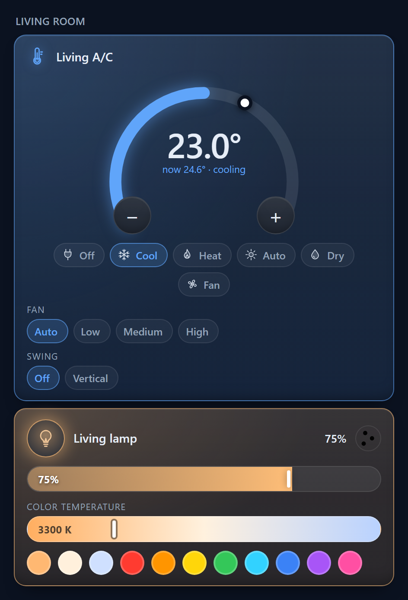
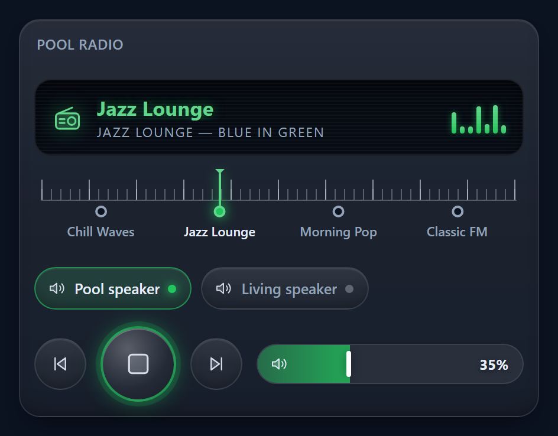
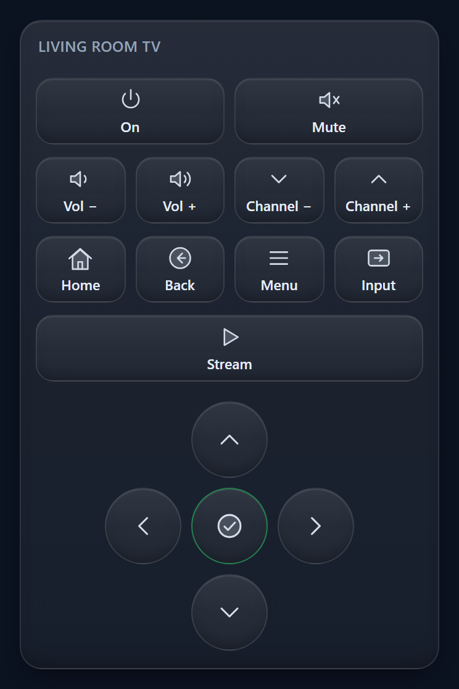
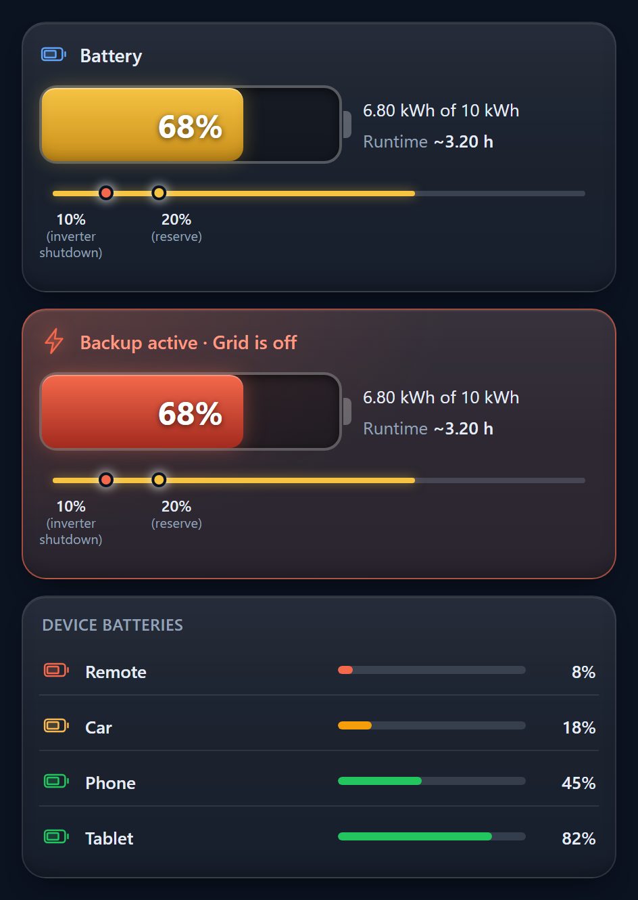
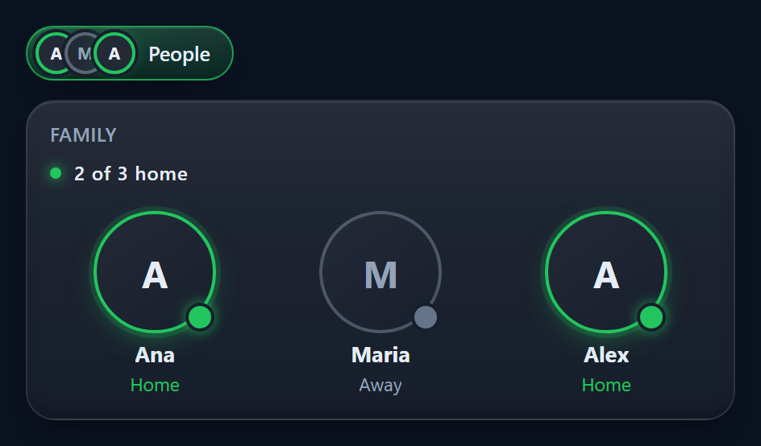
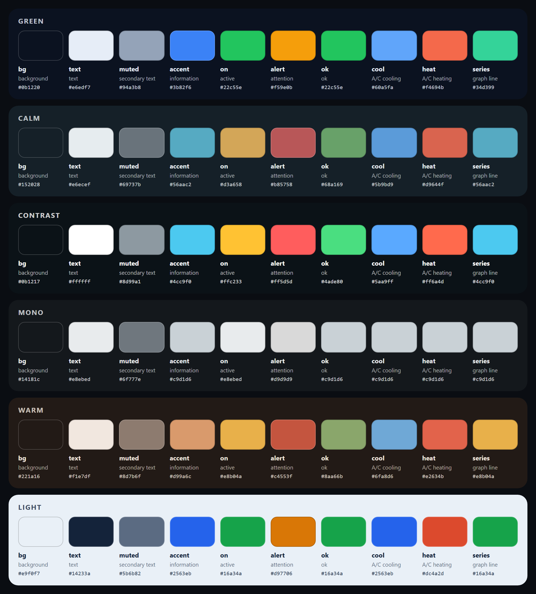

# Calm Modern UI (ccu)

[Română](README.ro.md) · English

A set of custom cards for [Home Assistant](https://www.home-assistant.io/) in a calm, modern style: glassy tiles, green for “active”, blue for information,
orange for attention. **One JavaScript file** (`ccu.js`), no external libraries, no network access, no telemetry.

Every card can be configured **from the Home Assistant UI** (no YAML needed), speaks **English and Romanian**, and works on phone, tablet and wall panels.

| Card | What it does |
|---|---|
| `ccu-buttons-card` | Grid of tiles (xs–xl): pills, horizontal tiles, switch rows, a “hero” tile with delta and sparkline, alert groups |
| `ccu-chips-card` | Status chips that can show only when active (A/C, rain, pumps…), text states, waste-collection calendar |
| `ccu-controls-card` | Thermostat / A/C dial, lights with brightness · colour temperature · quick colours, fan, media player, number, select |
| `ccu-radio-card` | Radio / music player with a tuning dial, equaliser display, station switching, volume and speaker selection |
| `ccu-remote-card` | TV remote (`remote.send_command`) with D-pad, volume, channels and custom keys |
| `ccu-flow-card` | Energy flow: solar / grid / battery → consumers, with percentages, sums, subtractions and statistics |
| `ccu-battery-card` | Battery bar with thresholds, runtime estimate and a “backup active” state |
| `ccu-batteries-card` | Battery levels of phones, tablets, cars… sorted, with a bar |
| `ccu-graph-card` | History graph (6 h … 30 d), 1–3 series, value on touch, optional tap action |
| `ccu-weather-card` | Values from *your* weather station, daily forecast and an animated scene (rain, snow, sleet, wind, storm, fog) |
| `ccu-people-card` | Who is home, as chips or large “family” avatars |
| `ccu-header-card` | One-line header: icon, up to 3 values, clock or an outdoor value |
| `ccu-nav-card` | Bottom navigation: back button, badges, conditional buttons, sticky |
| `ccu-title-card` | Section title with icon and subtitle |

## Gallery

<table>
<tr><td valign="top"></td><td valign="top"></td></tr>
<tr><td valign="top"></td><td valign="top"></td></tr>
<tr><td valign="top"></td><td valign="top"></td></tr>
<tr><td valign="top"></td><td valign="top"></td></tr>
<tr><td valign="top"></td><td valign="top"></td></tr>
<tr><td valign="top"></td><td valign="top"></td></tr>
</table>

## Installation

### HACS (recommended)

1. HACS → ⋮ → **Custom repositories** → add `https://github.com/adriantionut/ha-calm-modern-ui`, category **Dashboard**.
2. Install **Calm Modern UI**, then reload the browser (Ctrl+F5, or “force refresh” in the mobile app).

HACS adds the resource for you.

### Manual

1. Download `ccu.js` from the [latest release](https://github.com/adriantionut/ha-calm-modern-ui/releases/latest) and copy it to `config/www/ccu/ccu.js`.
2. **Settings → Dashboards → ⋮ → Resources → Add resource**: URL `/local/ccu/ccu.js?v=1`, type **JavaScript module**.
3. After each update change the number in `?v=` (otherwise the browser keeps the old file) and force-refresh.

### Try it

Add a card and pick **Calm Modern — Title**, or paste:

```yaml
type: custom:ccu-title-card
title: It works
subtitle: Calm Modern UI
```

## Visual editor (no YAML)

**Add card → Calm Modern — …** opens a form with entity and icon pickers, lists with ↑ ↓ ✕ buttons and a live preview. YAML stays available
(“Show code editor”); options the form does not cover (thresholds, `show_if`, `text_map`, `on_states`, …) are kept untouched when you save.

- **Energy flow**: the *Auto-detect sensors* button looks for solar, grid and battery power sensors by unit (W / kW) and name. Tick only what you have: Solar, Grid, Battery.
- Every card has a *Look and language* block (theme, language).
- Tap / hold / double-tap actions are picked from the Home Assistant action selector.

## Themes and colours

Six built-in themes (`green` is the default). Any card accepts `preset:` and `colors:`; every color of every theme is listed in [docs/COLORS.md](docs/COLORS.md).




Override any role on a single card (or all of them):


```yaml
preset: green        # default. Others: calm, contrast, mono, warm, light
colors:              # optional, overrides any colour
  on: '#22c55e'      # active
  alert: '#f59e0b'   # attention
  accent: '#3b82f6'  # information
  cool: '#60a5fa'    # A/C cooling
  heat: '#f4694b'    # A/C heating
  series: '#34d399'  # graph line
  bg: '#0b1220'      # background
animations: false    # turns every animation off (they also stop on “reduce motion”)
language: en         # optional; default is the Home Assistant profile language
```

Only valid colours are accepted (`#hex`, `rgb()`, `hsl()`, `var(--…)`); anything else is ignored with a warning on the card.
YAML tip: an unquoted `on` becomes `true`; the cards treat it as “on”, but quoting (`"on"`) is the safe form elsewhere.

## Actions

Every entity accepts `tap_action`, `hold_action` (500 ms) and `double_tap_action` (300 ms window):

```yaml
- entity: light.living
  tap_action: toggle              # toggle | more-info | navigate | call-service | url | none
  hold_action: { action: more-info }
  double_tap_action:
    action: call-service          # the UI editor’s `perform-action` works too
    service: light.turn_on
    service_data: { brightness_pct: 100 }
    target: { entity_id: light.living }
```

Default: lights, plugs, locks, covers and scenes → `toggle`; everything else → `more-info`.
Lights, plugs and fans are switched with `turn_on` / `turn_off` (many relays do not implement `toggle`).
`navigate` needs a full path (`/dashboard-home/rooms`); `url` accepts only `http:` / `https:`. Scrolling or moving more than 10 px cancels the gesture.

## Cards

### ccu-buttons-card


```yaml
type: custom:ccu-buttons-card
columns: 2            # 1–6 (narrow screens)
columns_wide: 3       # columns when the card is wide (≥ 420 px)
density: m            # xs | s | m | l | xl (default size)
panel: false          # true = panel with border and title
title: Rooms          # optional
entities:
  - light.kitchen                        # short form
  - entity: sensor.lab
    name: Lab
    icon: mdi:flask                      # own icon (mdi:… names are matched automatically)
    icon_color: yellow                   # green|yellow|orange|blue|cyan|red|white
    size: m
    shape: chamfer                       # chamfer | round | pill | square
    alert_above: 30                      # numeric sensor: above the threshold = attention
    secondary: { entity: sensor.lab_temp }   # secondary text: text | {attribute} | {entity} | false
```

Sizes: **xs** pill · **s** vertical · **m** horizontal tile · **l** wide row (`toggle: true` = switch) ·
**xl** hero: big value, `delta: { entity, percent_entity }`, `spark: { hours: 6 }`, `active: true`.
Powers in W from 1000 up are shown as kW (`auto_kw: false` keeps W).

Groups and alerts (also on chips):

```yaml
- entity: binary_sensor.cam1_person          # base entity (required)
  name: 📹 CAMERAS
  group: [binary_sensor.cam1_person, binary_sensor.cam2_person]   # lights up when ANY is “on”
  group_text: People on {n} cameras
  group_idle: No activity
```

### ccu-chips-card


```yaml
type: custom:ccu-chips-card
entities:
  - { entity: climate.ac_living, name: A/C, icon: mdi:air-conditioner, hide_off: true }   # shows only when on; if no chip is visible the whole card disappears
  - { entity: sensor.feels_like, name: Feels like, show_state: true, alert_above: 32, hide_off: true }
  - entity: sensor.washer_status
    name: Washer
    hide_off: true
    show_state: true
    on_states: [running, spinning, rinsing]               # which text states mean “active”
    text_map: { spinning: Spin, running: Wash }           # translate the shown state
    secondary: { entity: sensor.washer_remaining_time }   # a timestamp sensor shows “38 min” / “done”
  - { entity: group.all_lights, icon: mdi:lightbulb, count: true, hide_off: true }        # number of members that are on
waste:                                                    # chips from a waste-collection calendar
  calendar: calendar.waste
  next_days: 1
  hide_today_after: '11:00'
  patterns:
    - { match: 'Waste: General', label: General, icon: mdi:trash-can, exact: true }
```

### ccu-controls-card


```yaml
type: custom:ccu-controls-card
title: Climate          # optional
columns: 1              # 1–3
items:
  - { entity: climate.living_ac, name: Living A/C }   # dial: big target, +/−, modes, fan / swing / preset; style: simple = compact
  - { entity: light.strip_rgb, name: Strip }          # round on/off + brightness slider, colour temperature, quick colours; an on/off-only bulb becomes a simple tile
  - { entity: fan.ventilation, labels: { night: Night } }
  - { entity: media_player.tv }                        # title, transport, mute, volume
  - { entity: number.timer, name: Timer }              # slider with min / max / step from the entity
  - { entity: select.program, name: Program }
```

### ccu-radio-card


```yaml
type: custom:ccu-radio-card
title: Pool radio
stations: input_select.radio_favorite       # options like "Name - https://stream.url" (the URL part is hidden)
player: media_player.pool_speaker           # main speaker: volume + availability
speakers:                                   # optional: several speakers, with buttons to choose where it plays
  - media_player.pool_speaker
  - media_player.living_speaker
playing: input_boolean.radio_playing        # optional
play: script.radio_play                     # optional: your scripts; without them the card sends the stream URL to the chosen speaker
stop: script.radio_stop
hide: [Custom]                              # hide stations containing these words
```

### ccu-remote-card


```yaml
type: custom:ccu-remote-card
entity: remote.living_room_tv        # remote.send_command
dpad: true
commands: { power: KEY_POWER, volu: KEY_VOLUP }       # rename commands for another TV model
rows: [[power, mute], [vold, volu, chd, chu]]         # keys and order: power mute vold volu chd chu home back menu input
extra:
  - { label: Netflix, icon: play, command: KEY_11 }   # custom keys
```

### ccu-flow-card


```yaml
type: custom:ccu-flow-card
title: Energy flow
solar: sensor.solar_power
grid:    { entity: sensor.meter_active_power, invert: true }   # convention: + = import; invert if your sensor is + on export
battery: { entity: sensor.battery_power, soc: sensor.battery_soc }   # + = discharging
consumers:                  # up to 6; the percentage is of Total (sum of consumers)
  - { entity: sensor.house_power, subtract: [sensor.pool_power], name: House, icon: mdi:home }   # value minus other entities (min 0)
  - { entities: [sensor.shed_a, sensor.shed_b, sensor.shed_c], name: Shed, icon: mdi:warehouse }   # sum of several entities (e.g. 3 phases)
stats:                      # up to 4, bottom row
  - { entity: sensor.grid_import_today, label: Import today, icon: mdi:transmission-tower }
```

Shown signs: grid — export “+”, import “−”; battery — charging “+”, discharging “−”. A source with no exchange (solar at night, battery idle, grid ~0) draws no ribbon.
`hide_idle: false` keeps a consumer under 10 W visible.

### ccu-battery-card · ccu-batteries-card


```yaml
type: custom:ccu-battery-card
soc: sensor.battery_soc
capacity_entity: sensor.battery_capacity      # or capacity_kwh: 38.6
load: sensor.load_power                       # for the runtime estimate
grid_present: binary_sensor.grid              # off = “Backup active”
reserve_pct: 20
shutdown_pct: 10
```

```yaml
type: custom:ccu-batteries-card
title: Device batteries
warn_pct: 20          # below = orange
low_pct: 10           # below = red
entities:
  - { entity: sensor.tablet_battery_level, name: Tablet }
  - sensor.phone_battery_level
```

### ccu-graph-card


```yaml
type: custom:ccu-graph-card
title: Energy (last 6 h)
range: 6h                 # 6h | 12h | 24h | 7d | 30d
tabs: [24h, 7d]           # optional range tabs
y_axis: right
height: 150               # 60–400
compact: true             # legend in the title row
tap_action: { action: navigate, navigation_path: /dashboard-home/energy }   # optional: tap opens the page of this graph
series:                   # 1–3 series
  - { entity: sensor.consumption, name: Consumption, color: accent, kind: area }
  - { entity: sensor.solar, name: Solar, color: yellow, kind: line }
```

### ccu-weather-card


Current values come from **your station sensors**, the daily forecast from the `weather.*` entity.

```yaml
type: custom:ccu-weather-card
title: Weather
weather: weather.home
sensors:                              # all optional; a tile shows only if it has a sensor
  temperature: sensor.outdoor_temperature
  humidity: sensor.humidity
  wind_speed: sensor.wind_speed       # km/h, m/s, mph or kn (converted)
  rain_rate: sensor.rain_rate
  pressure: sensor.pressure
  uv: sensor.uv_index
tiles: [humidity, wind, rain, pressure, uv, radiation]
days: 5                               # 1–7
```

### ccu-people-card · ccu-header-card · ccu-nav-card · ccu-title-card


```yaml
type: custom:ccu-people-card
layout: family        # large avatars with name and state
people: [person.ana, person.maria]
```

```yaml
type: custom:ccu-header-card
header:
  icon: home
  values:                       # up to 3
    - { entity: sensor.consumption, icon: bolt, color: accent, label: Load }
  right: { entity: weather.home, attribute: temperature, label: outside }   # replaces the clock
```

```yaml
type: custom:ccu-nav-card
sticky: true
compact: true
items:
  - { back: true, icon: back, label: Back }
  - { icon: home, label: Home, path: /dashboard-home/0 }
  - { icon: camera, label: Cams, path: /dashboard-home/cams, badge: [binary_sensor.cam1_person] }
  - { icon: tablet, label: Tablet, path: /dashboard-home/tablet, visible_if: { entity: sensor.browser_user, state: Tablet } }
```

```yaml
type: custom:ccu-title-card
title: Kitchen
subtitle: Climate · lights
icon: pot
```

## Languages

Cards speak the Home Assistant language (`hass.locale.language`): **English** and **Romanian** are included; any other language falls back to English.
Pin it on a card with `language: en` or `language: ro`. Numbers use the language’s separators (`1,234.5` / `1 234,5`).

Adding a language does not touch the rest of the code: in `src/i18n.mjs`, add a dictionary to `DICT` (key = the Romanian source phrase, value = your translation);
missing phrases fall back to English. `tests/i18n.test.mjs` checks that every `t('…')` in the code has an English translation.

## Icons

~120 own icons (`src/icons.mjs`) and hundreds of `mdi:…` aliases; an unknown `mdi:` name falls back to the icon of the entity’s domain.

## Development

```bash
node build.mjs          # builds ccu.js from src/*.mjs (no dependencies)
node tests/run-all.mjs  # all tests
```

`docs/demo/index.html` is a demo with a fake Home Assistant (invented entities); `node docs/demo/capture.mjs` regenerates the screenshots in `docs/img` with headless Chrome.

Project rules: no network and no libraries; the DOM is updated in place; every config text is escaped; a missing value becomes “—”, never `NaN` / `undefined`.
See [CONTRIBUTING.md](CONTRIBUTING.md).

## License

MIT
