# Calm Modern UI (ccu)

Română · [English](README.md)

Set de carduri pentru Home Assistant, într-un stil calm și modern: plăci sticloase, verde pentru „activ”, albastru pentru informație,
portocaliu pentru atenție. Un singur fișier JavaScript (`ccu.js`), fără rețea, fără biblioteci externe, fără `INTERNET` către terți.


| Card | Ce face |
|---|---|
| `ccu-buttons-card` | Grilă de butoane xs–xl: pastile, plăci orizontale, rând cu comutator, card „erou” cu variație și grafic mic |
| `ccu-chips-card` | Rând de chips cu stare (aprins/alertă/ok), inclusiv aer condiționat cu ventilator care se învârte |
| `ccu-header-card` | Bandă pe un rând: iconiță, până la 3 valori, ceas sau o valoare în dreapta (ex. temperatura exterioară) |
| `ccu-nav-card` | Meniu de jos; pagina curentă e evidențiată automat |
| `ccu-graph-card` | Grafic de istoric (6 h / 24 h / 7 zile / 30 zile), 1–3 serii, valoare la atingere |
| `ccu-flow-card` | Flux energetic: solar / rețea / baterie → consumatori, cu procente și statistici |
| `ccu-battery-card` | Baterie cu bară, praguri (oprire / rezervă), autonomie și stare „Backup activ” |
| `ccu-people-card` | Avatare suprapuse: cine e acasă are cerc verde |
| `ccu-weather-card` | Vreme: valori din stația ta (Ecowitt etc.), prognoză pe 5 zile și scenă animată (ploaie, lapoviță, ninsoare, vânt, furtună, ceață, senin/noapte) |

## Galerie

<table>
<tr><td valign="top"></td><td valign="top">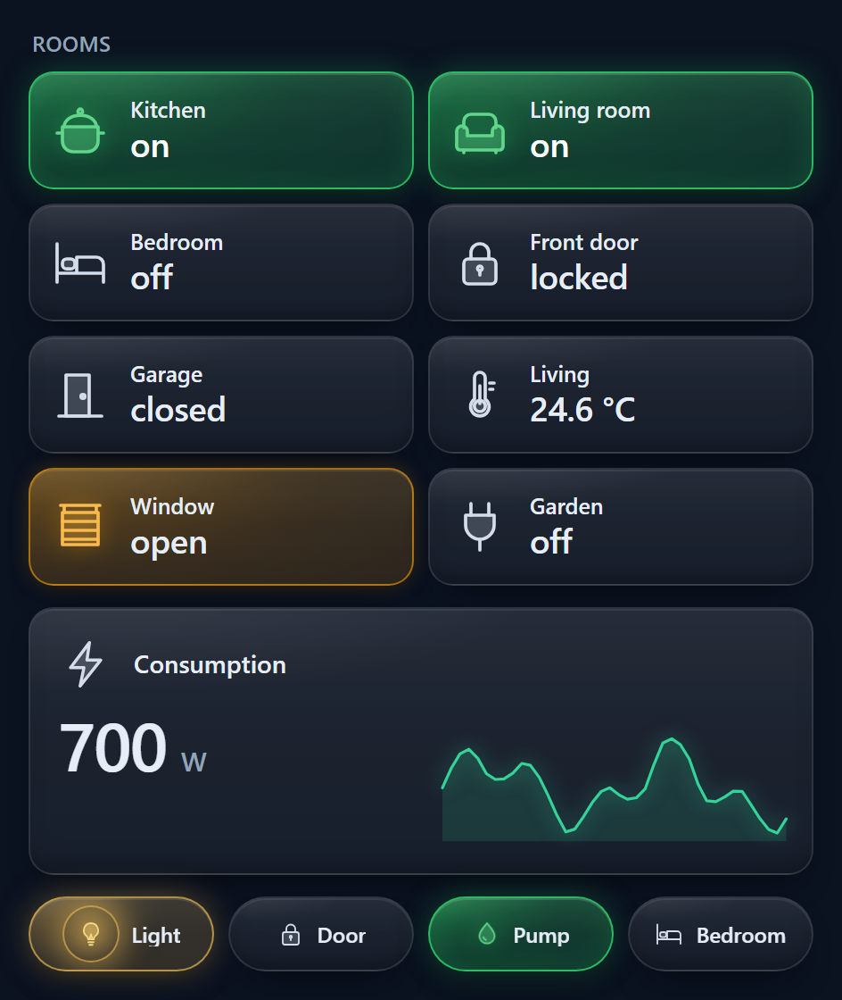</td></tr>
<tr><td valign="top">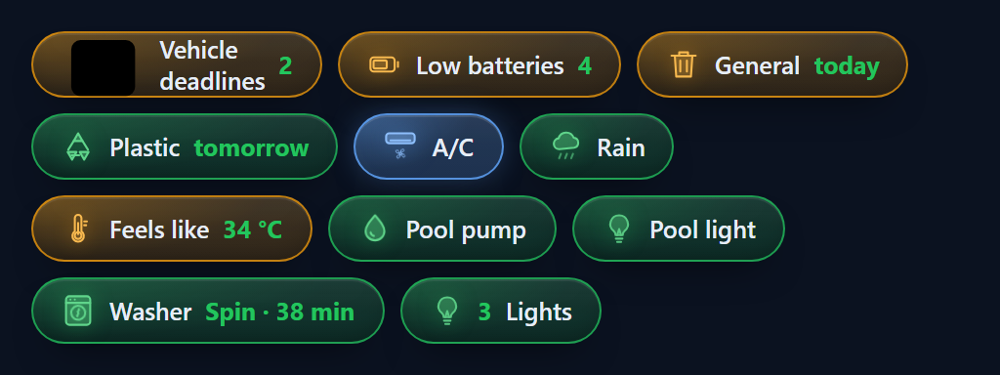</td><td valign="top">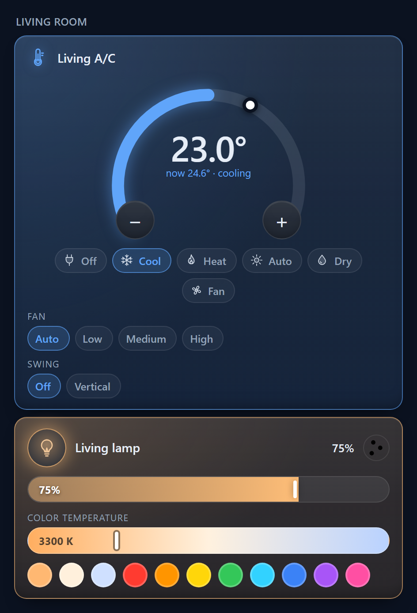</td></tr>
<tr><td valign="top">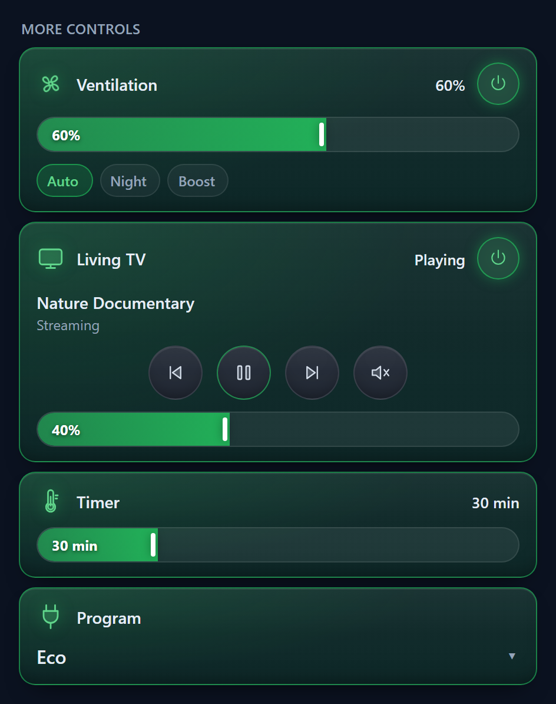</td><td valign="top">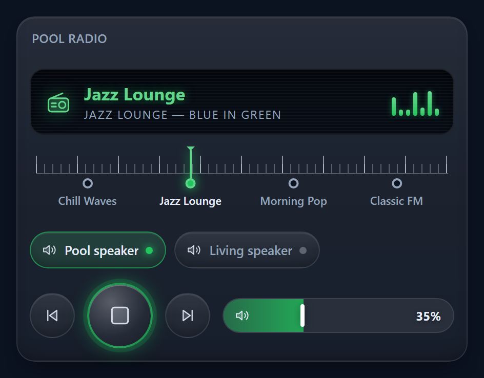</td></tr>
<tr><td valign="top"></td><td valign="top">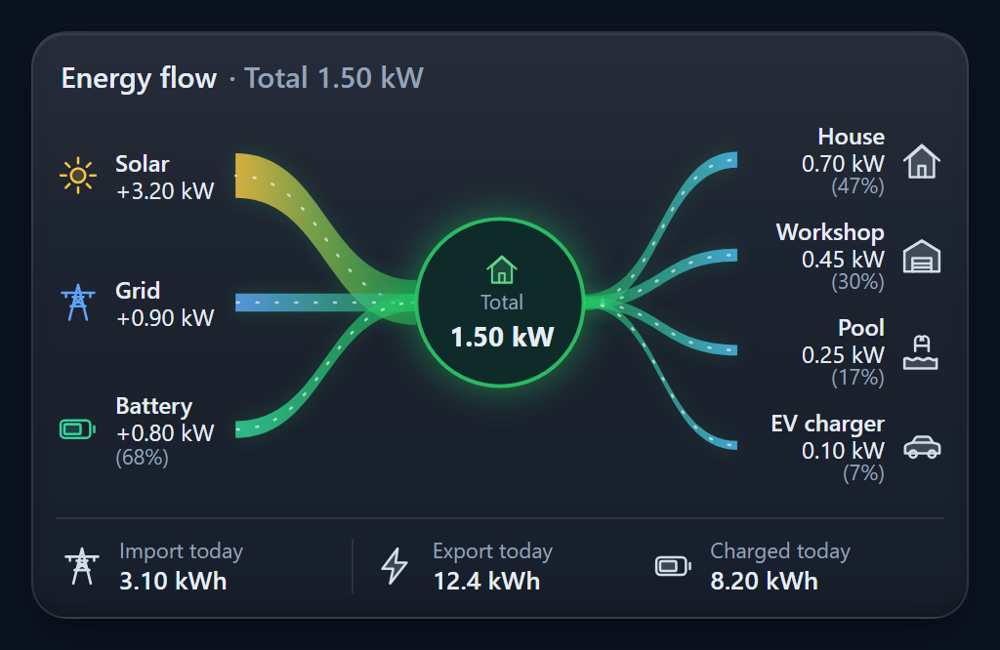</td></tr>
<tr><td valign="top">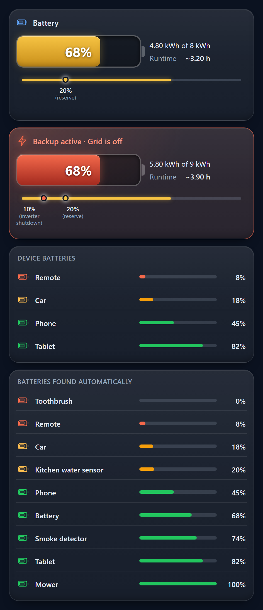</td><td valign="top">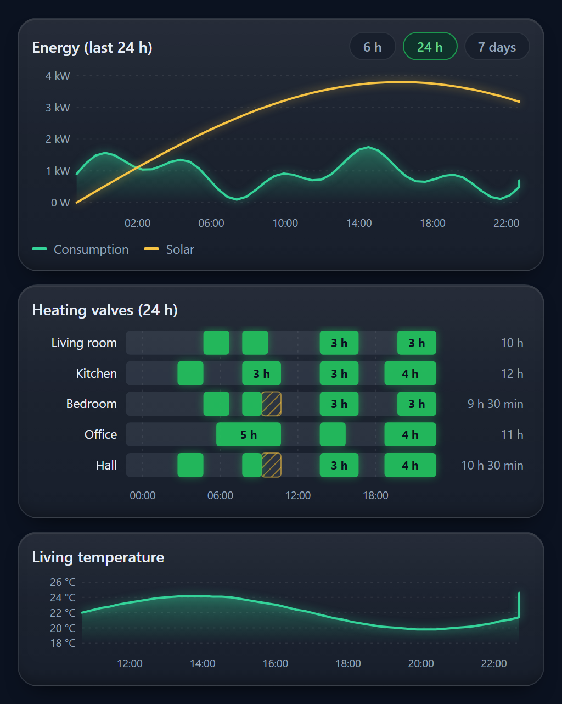</td></tr>
<tr><td valign="top">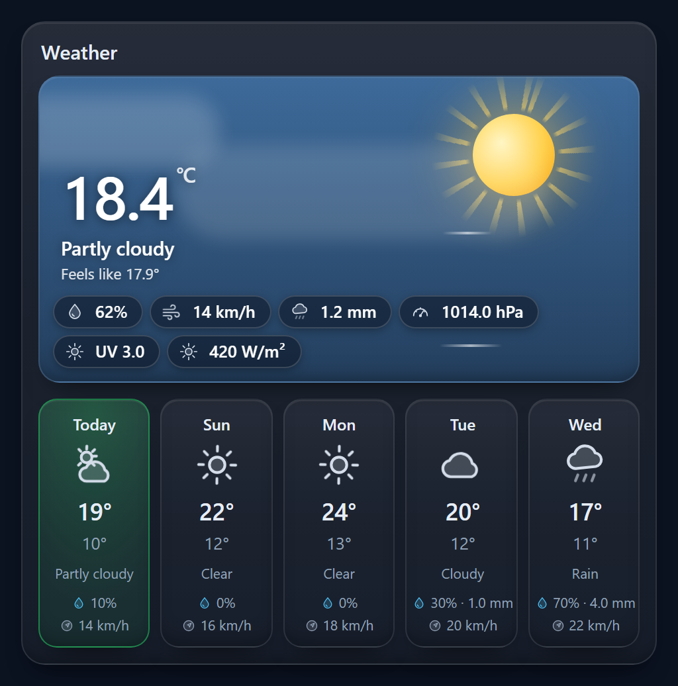</td><td valign="top">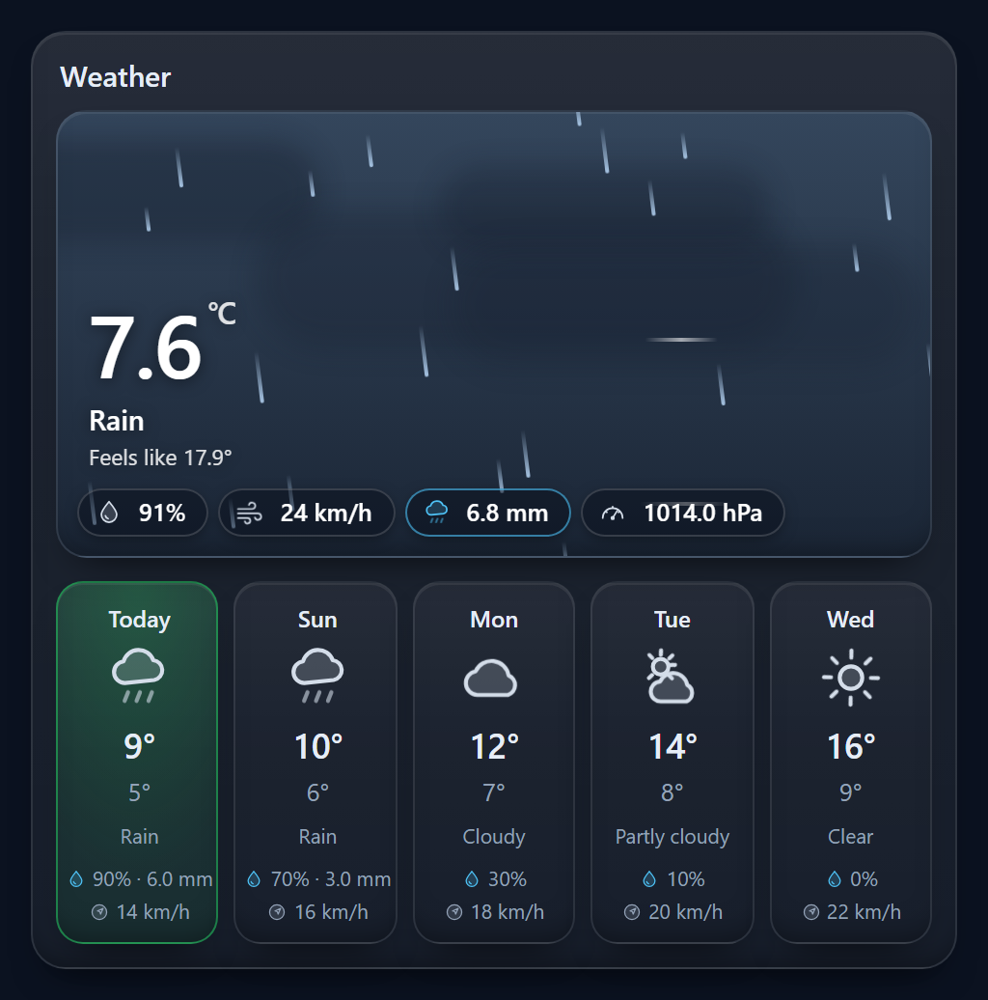</td></tr>
<tr><td valign="top"></td><td valign="top">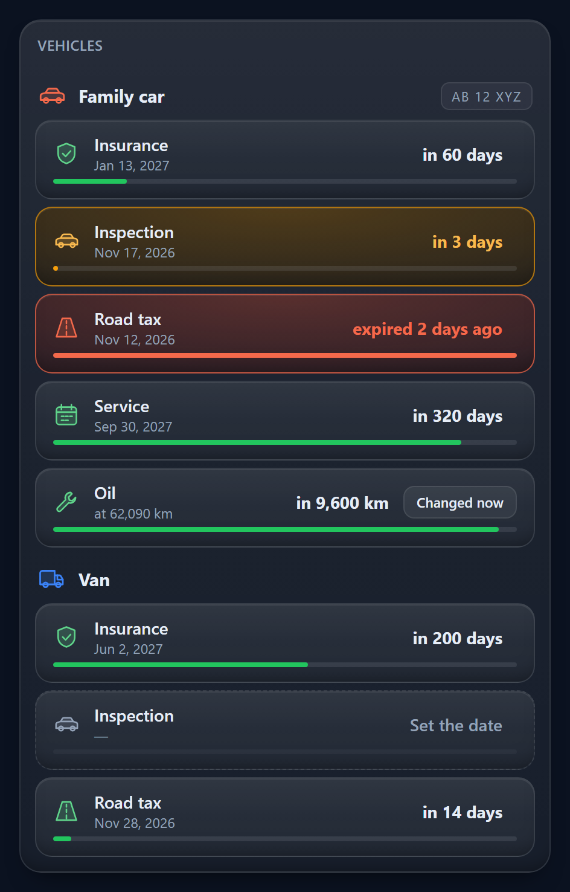</td></tr>


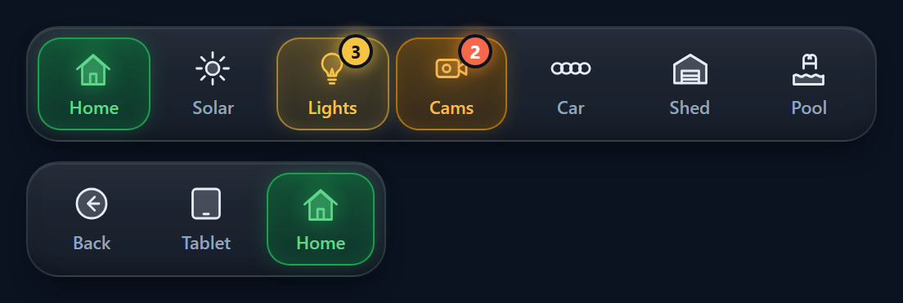
<tr><td valign="top"></td><td valign="top"></td></tr>
</table>

## Iconițe animate

Iconițele se mișcă doar când are sens și doar cât aparatul e pornit: ventilatorul unui aparat de aer condiționat se învârte cât timp chiar răcește, becul strălucește, centrala pâlpâie, pompa sau boxa pulsează. Animațiile se opresc la „reduce motion” (sau cu `animations: false`).

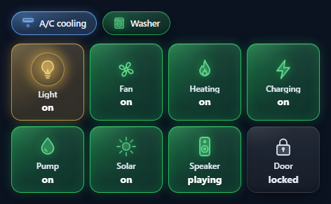

### Mișcare și baterie


Animațiile continue țin ecranul ocupat, ceea ce consumă baterie pe telefon. Fiecare card are opțiunea `motion` (și în editorul vizual, la *Aspect și limbă*):

| `motion` | Ce face |
|---|---|
| `auto` (implicit) | tabletă și PC: `full`; telefon (latura mică a ecranului sub 600 px): `calm` |
| `full` | animații continue, ca înainte |
| `calm` | aceleași animații, dar doar câteva cicluri (cam 6–10 s) după fiecare schimbare de stare, apoi static până la următoarea schimbare sau reîmprospătare. Ploaia, ninsoarea, vântul și fulgerele din cardul meteo sunt ascunse |
| `off` | nimic nu se mișcă |

```yaml
motion: full            # de ex. mișcare completă și pe telefon
weather_effects: off    # cardul meteo: auto | on | off (ploaie, ninsoare, nori)
flow_animation: auto    # cardul de flux: auto | on | off (punctele care curg pe panglici)
```

`weather_effects` și `flow_animation` urmează `motion`, dacă nu le setezi. `animations: false` oprește tot, ca înainte. „Reduce motion” din setările sistemului rămâne respectat.

## Instalare

1. Copiază `ccu.js` în `config/www/ccu/ccu.js` (apare ca `/local/ccu/ccu.js`).
2. **Setări → Tablouri de bord → ⋮ → Resurse → Adaugă resursă**: URL `/local/ccu/ccu.js?v=1`, tip **Modul JavaScript**.
3. La fiecare actualizare a fișierului schimbă numărul din `?v=` (altfel browserul ține varianta veche).
4. Reîncarcă pagina (Ctrl+F5 / „Reîncarcă forțat” în aplicația mobilă).

HACS: **Repository-uri personalizate** → `https://github.com/adriantionut/ha-calm-modern-ui`, categoria **Dashboard**; fișierul servit e `ccu.js`.

## Editor vizual (fără YAML)

Toate cardurile se configurează din interfața Home Assistant: **Adaugă card → Calm Modern — …** deschide un formular cu selectoare de entități și de iconițe,
liste cu ↑ ↓ ✕ și o previzualizare în direct. YAML-ul rămâne disponibil (butonul „Arată editorul de cod”), iar opțiunile pe care formularul nu le acoperă
(praguri, `show_if`, `text_map`, `on_states`…) se păstrează neatinse la salvare.

- **Flux de energie:** butonul „Detectează automat senzorii” caută senzorii de solar, contor și baterie după unitate (W / kW) și nume; bifezi doar ce ai (Solar, Rețea, Baterie).
- Textele editorului urmează limba Home Assistant (engleză sau română) și au un bloc „Aspect și limbă” (temă, limbă) pe fiecare card.
- Acțiunile (la atingere / apăsare lungă / dublă atingere) se aleg din selectorul HA și sunt înțelese direct de carduri (`perform-action`).

## Presetări și culori

Șase teme incluse (`green` e implicită). Orice card acceptă `preset:` și `colors:`; toate culorile fiecărei teme sunt în [docs/COLORS.md](docs/COLORS.md).

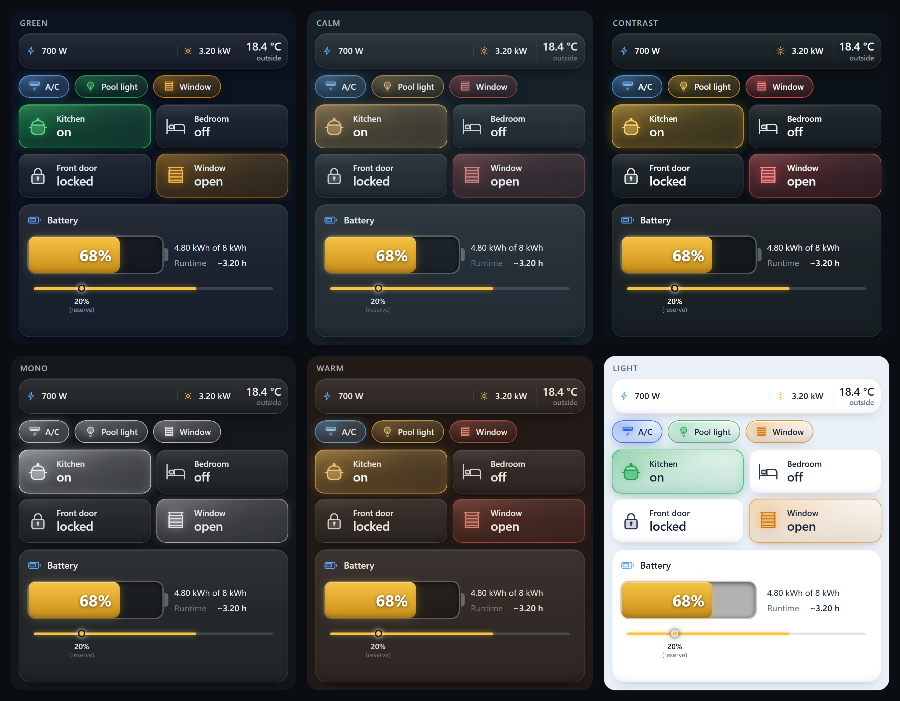

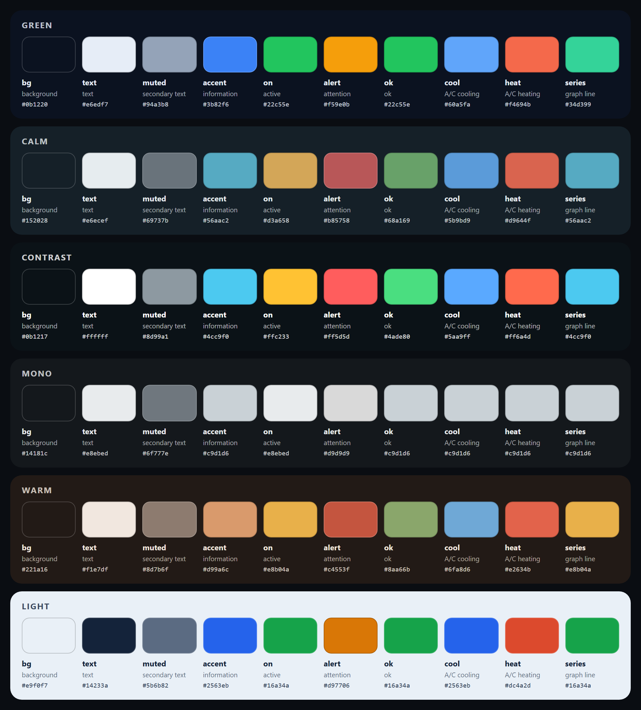

Suprascrie orice rol pe un card:


```yaml
preset: green        # implicit. Mai sunt: calm, contrast, mono, warm, light
colors:              # opțional, suprascrie orice culoare
  on: '#22c55e'      # activ
  alert: '#f59e0b'   # atenție
  accent: '#3b82f6'  # informație
  cool: '#60a5fa'    # aer condiționat pe răcire
  heat: '#f4694b'    # aer condiționat pe încălzire
  series: '#34d399'  # linia graficelor
  bg: '#0b1220'      # fundal
```

Sunt acceptate doar culori valide (`#hex`, `rgb()`, `hsl()`, `var(--…)`); orice altceva e ignorat cu un avertisment pe card.

> **Capcană YAML:** `on` fără ghilimele devine `true` (și cheia `on:` devine `"true"`). Cardurile le tratează ca „on”, deci
> `colors: { on: '#22c55e' }` și `color: on` merg; ghilimelele (`"on"`) sunt totuși varianta sigură în alte câmpuri.
`animations: false` oprește toate animațiile; animațiile se opresc singure și la „reduce motion”.

## Acțiuni (toate cardurile cu entități)

Pe fiecare entitate: `tap_action`, `hold_action` (500 ms), `double_tap_action` (fereastră 300 ms).

```yaml
- entity: light.living
  tap_action: toggle              # toggle | more-info | navigate | call-service | url | none
  hold_action: { action: more-info }
  double_tap_action:
    action: call-service
    service: light.turn_on
    service_data: { brightness_pct: 100 }
    target: { entity_id: light.living }
```

Implicit: lumini, prize, lacăte, jaluzele, scene → `toggle`; restul → `more-info`. Derularea paginii și mișcarea de peste 10 px anulează gestul.
`navigate` cere adresă completă (`/dashboard-x/view`); `url` acceptă doar `http:` / `https:`.

## ccu-buttons-card


```yaml
type: custom:ccu-buttons-card
columns: 2            # 1–6 (coloane pe ecran îngust)
columns_wide: 3       # coloane când cardul e lat (≥ 420 px)
density: m            # xs | s | m | l | xl (mărimea implicită)
panel: false          # true = panou cu chenar și titlu
title: Camere         # opțional
entities:
  - light.bucatarie                      # formă scurtă
  - entity: sensor.lab
    name: Lab
    icon: mdi:flask                      # iconiță proprie (mdi:… se potrivește automat)
    icon_color: yellow                   # green|yellow|orange|blue|cyan|red|white
    size: m
    shape: chamfer                       # chamfer | round | pill | square
    alert_above: 30                      # senzor numeric: peste prag = atenție
    secondary: { entity: sensor.lab_temp }   # text secundar: text | {attribute} | {entity} | false
    colors: { on: '#ff8800' }            # culori doar pentru această plăcuță
```

Mărimi: **xs** pastilă · **s** vertical (orizontal pe ecran lat) · **m** placă orizontală · **l** rând lat (`toggle: true` = comutator) ·
**xl** erou: valoare mare, `delta: { entity, percent_entity }`, `spark: { hours: 6 }` (grafic mic din istoric), `active: true` (verde permanent).
Puterile în W de la 1000 în sus se arată în kW (`auto_kw: false` le păstrează în W).

### Opțiuni pentru „alerte” și „grupuri” (pe butoane și pe chips)

```yaml
# 📹 un buton care se aprinde (atenție) când ORICARE dintre senzorii listați e „on”, cu text după număr
- entity: binary_sensor.casa_cam1_person_occupancy      # entitate de bază (obligatorie)
  name: 📹 CAMERE
  group: [binary_sensor.casa_cam1_person_occupancy, binary_sensor.hala_cam1_person_occupancy]
  group_text: Persoane pe {n} camere
  group_idle: Fără activitate

# chips care apar doar când sunt „on”, cu numărul de membri porniți dintr-un group.*
- { entity: group.all_lights, icon: mdi:lightbulb, count: true, hide_off: true }
- { entity: group.smoke_alarm, icon: mdi:fire-alert, hide_off: true, on_as: alert }   # on_as: alert = roșu/portocaliu, nu „activ”
```

## ccu-chips-card


```yaml
type: custom:ccu-chips-card
entities:
  - { entity: light.sufragerie, name: Lumini, icon: mdi:lightbulb, icon_color: yellow, show_state: true }
  - { entity: climate.ac_living, name: AC, icon: mdi:air-conditioner }   # răcire = albastru, încălzire = roșu, auto = verde; ventilatorul se învârte cât timp aparatul lucrează
```

## ccu-header-card

```yaml
type: custom:ccu-header-card
header:
  icon: home
  values:                       # maximum 3
    - { entity: sensor.temperatura, icon: thermo, color: accent, label: (medie) }
    - { entity: sensor.solar, icon: sun, color: on, label: Solar }
    - { entity: sensor.baterie_soc, icon: battery, color: ok, label: Baterie }
  right: { entity: weather.acasa, attribute: temperature, label: afară }   # în locul ceasului; fără right apare ceasul
```

## ccu-nav-card

```yaml
type: custom:ccu-nav-card
items:
  - { icon: home,  label: Home,  path: /dashboard-casa/0 }
  - { icon: sun,   label: Solar, path: /dashboard-casa/solar, match: /dashboard-casa/solar }
```

## ccu-graph-card


```yaml
type: custom:ccu-graph-card
title: Energie (ultimele 6 h)
range: 6h                 # 6h | 12h | 24h | 7d | 30d | { hours: 36 }
tabs: [24h, 7d]           # file pentru schimbarea intervalului (opțional)
y_axis: right             # etichetele Y în dreapta (opțional)
height: 150
refresh_minutes: 5
series:                   # 1–3 serii; a doua cu altă unitate primește axă în dreapta
  - { entity: sensor.consum, name: Consum, color: accent, kind: area }
  - { entity: sensor.solar,  name: Solar,  color: yellow, kind: line }
```

Istoricul se cere cu `history/history_during_period` (un singur apel pentru toate seriile); fără istoric apare „fără date istorice”.

## ccu-flow-card


```yaml
type: custom:ccu-flow-card
title: Flux energie
solar: sensor.solar_total_power
grid:    { entity: sensor.power_meter_active_power, invert: true }   # convenție: + = import; invert dacă senzorul tău e + la export
battery: { entity: sensor.invertor_deye_battery_power, soc: sensor.invertor_deye_battery }   # + = descărcare
consumers:                  # maximum 6; procentul e din Total (suma consumatorilor)
  - { entity: sensor.casa_consum_izolat, name: Casă, icon: mdi:home }
stats:                      # maximum 3, rândul de jos
  - { entity: sensor.import_retea_zilnic, label: Import azi, icon: mdi:transmission-tower }
```

## ccu-battery-card


```yaml
type: custom:ccu-battery-card
soc: sensor.invertor_deye_battery
capacity_entity: sensor.invertor_deye_battery_capacity   # sau capacity_kwh: 38.6
load: sensor.invertor_deye_load_power                    # pentru autonomie (până la rezervă, la consumul curent)
grid_present: binary_sensor.invertor_deye_grid           # off = „Backup activ”; unavailable NU declanșează backup
reserve_pct: 20
shutdown_pct: 10
color: yellow                                            # yellow | green | blue | orange
```

Cum se calculează (exact, din procente și capacitate; se rotunjește doar la afișare):

- **Cu rețea**: banda utilizabilă e `reserve_pct` → 100 %. Cardul arată energia din bandă, „X kWh din Y kWh”, cu Y = (100 − rezervă)% × capacitate, și autonomia până la rezervă, la consumul curent.
- **Fără rețea (backup activ)**: banda devine `shutdown_pct` → 100 %, același „X kWh din Y kWh” și autonomia până la pragul de oprire. Doar atunci apar „Backup activ” și marcajul de oprire.
- Schimbi `reserve_pct` (de exemplu 20 → 30) și totul se recalculează. Procentul mare e mereu starea reală de încărcare.


## ccu-batteries-card

```yaml
type: custom:ccu-batteries-card
title: Niveluri baterii dispozitive
warn_pct: 20          # sub = portocaliu
low_pct: 10           # sub = roșu
sort: asc             # crescător (implicit) sau none
entities:
  - { entity: sensor.ipad_battery_level, name: Tableta }
  - sensor.nff_battery_level
```

`auto` găsește toate dispozitivele cu senzor de baterie (`device_class: battery`), fără telefoane, tablete și browsere; `only_low: true` arată doar bateriile slabe:

```yaml
type: custom:ccu-batteries-card
title: Dispozitive pe baterii
auto: { threshold: 20, exclude: [invertor, audi], include: [sensor.alta_baterie] }
```


## ccu-people-card


```yaml
type: custom:ccu-people-card
people: [person.alex, person.maria]
label: Persoane            # false = fără etichetă
```

`layout: family` face din el cardul „Familia”: avatare mari cu nume și stare (Acasă / Plecat / zona), cu `title: Familia 👨‍👩‍👧‍👦`.

Poza vine din `entity_picture` și e acceptată doar dacă e o cale relativă la Home Assistant (`/api/image/…`, `/local/…`); altfel se arată inițialele.

## ccu-weather-card


Valorile curente (temperatură, umiditate, vânt, ploaie, presiune, UV, radiație) vin **din senzorii stației tale**, nu din prognoză;
prognoza pe zile vine din entitatea `weather.*` (serviciul `weather.get_forecasts`, tip `daily`, reîmprospătat la 30 de minute).

```yaml
type: custom:ccu-weather-card
title: Vremea
weather: weather.acasa                # pentru prognoză și pentru cerul din scenă
sensors:                              # toate opționale; un tile apare doar dacă are senzor
  temperature: sensor.gw2000a_outdoor_temperature
  feels_like: sensor.gw2000a_feels_like_temperature
  humidity: sensor.gw2000a_humidity
  wind_speed: sensor.gw2000a_wind_speed        # km/h, m/s, mph sau kn (se convertesc)
  wind_gust: sensor.gw2000a_wind_gust
  wind_direction: sensor.gw2000a_wind_direction
  rain_rate: sensor.gw2000a_rain_rate_piezo    # mm/h sau in/h
  rain_today: sensor.gw2000a_daily_rain_piezo
  rain_state: binary_sensor.gw2000a_rain_state_piezo
  pressure: sensor.gw2000a_relative_pressure
  uv: sensor.gw2000a_uv_index
  radiation: sensor.gw2000a_solar_radiation
tiles: [humidity, wind, rain, pressure, uv, radiation]   # și: lux, dew_point, feels_like, gust
days: 5                               # 1–7
hold_action: { action: navigate, navigation_path: /dashboard-casa/vreme }   # tap_action / hold_action pe scenă și pe zile
scene_fallback: true                  # când senzorii lipsesc, scena folosește starea entității weather („după prognoză”)
fallback_to_forecast: false           # true = arată și temperatura din prognoză când senzorul lipsește
```

Scena se alege din senzori: **ploaie** peste 2,5 °C, **lapoviță** între 0,5 și 2,5 °C, **ninsoare** sub 0,5 °C (intensitatea după mm/h),
**vânt** de la 12 km/h (dungi care traversează scena, picăturile se înclină), **furtună** când entitatea weather spune `lightning*`,
plus senin / parțial noros / noros / ceață, ziua sau noaptea (din `sun.sun`). Fără senzor, tile-ul arată „—”; animațiile se opresc la „reduce motion”.

## Chips: opțiuni suplimentare

```yaml
type: custom:ccu-chips-card
entities:
  - { entity: climate.ac_hala, name: A/C Hală, icon: mdi:air-conditioner, hide_off: true }          # apare doar când e pornit; dacă niciun chip nu e vizibil, tot cardul dispare (nu ocupă loc)
  - { entity: sensor.feels_like, name: Se simte, show_state: true, alert_above: 32, hide_off: true }  # apare doar peste prag
  - { entity: sensor.citire_gaz, name: Gaz, show_state: true, show_if: { attribute: days_left, min: 0, alert_at: 1 } }   # se vede doar când atributul ≥ min; alertă când ≤ alert_at
  - entity: sensor.masina_de_spalat_current_status      # stare text → „pornit”
    name: Mașină de spălat
    hide_off: true
    show_state: true
    on_states: [running, spinning, rinsing]             # ce stări înseamnă „activ” (pentru senzori text)
    text_map: { spinning: Centrifugă, running: Spală }  # traduce starea afișată
    secondary: { entity: sensor.masina_de_spalat_remaining_time }   # a doua valoare; un senzor timestamp se arată „38 min” / „gata”
waste:                                                  # chips din calendarul de colectare a gunoiului
  calendar: calendar.colectare_gunoi
  next_days: 1                                          # azi + mâine
  hide_today_after: '11:00'                             # azi se ascunde după această oră
  patterns:
    - { match: 'Gunoi: Menajer', label: Menajer, icon: mdi:trash-can, exact: true }
```

Chip **baterii slabe**, care găsește singur dispozitivele pe baterii (senzori de baterie; telefoanele și tabletele sunt lăsate deoparte):

```yaml
type: custom:ccu-chips-card
low_batteries:
  threshold: 20                 # slabă = până la acest procent (implicit 20)
  exclude: [invertor, audi]     # cuvinte din nume / entity_id care se exclud
  tap_action: { action: navigate, navigation_path: /dashboard-casa/baterii }   # implicit: more-info pe cea mai slabă
```

Apare doar când ceva e slab: numărul („Baterii slabe 3”) sau, dacă e una singură, numele și nivelul ei.


Pe butoane, `text_map` traduce textul stării (când nu e dat `secondary`).

## ccu-nav-card — opțiuni suplimentare

```yaml
type: custom:ccu-nav-card
sticky: true          # fix pe ecran cât derulezi; un spațiu gol rezervă locul (spacer: false îl scoate)
compact: true         # capsulă îngustă, centrată (în loc de bară pe toată lățimea)
labels: false         # doar iconițe, fără nume
items:
  - { back: true, icon: back, label: Înapoi }                                          # history.back
  - { icon: tablet, label: Tableta, path: /dashboard-casa/calm, visible_if: { entity: sensor.browser_user, state: Tableta } }   # se vede doar când starea se potrivește
  - { icon: camera, label: Cam, path: /dashboard-casa/camere, badge: [binary_sensor.cam1_person, binary_sensor.cam2_person] }  # insignă cu câte entități sunt „on”; butonul devine portocaliu

  - { icon: bulb, label: Lumini, path: /light, badge: [sensor.becuri_aprinse], badge_style: light }   # insignă galbenă cu numărul de becuri aprinse (un senzor numeric adaugă valoarea lui)
```

## ccu-graph-card — opțiuni suplimentare

`height: 60–400` (înălțimea graficului); `compact: true` urcă legenda în rândul titlului, deci cardul e mai scund. Etichetele axei Y se lățesc după cea mai lungă etichetă (ex. „2 000 ppb”).

## ccu-flow-card — opțiuni suplimentare

```yaml
consumers:
  - { entity: sensor.casa_consum_izolat, subtract: [sensor.piscina_total_power], name: Casă, icon: mdi:home }      # valoarea minus alte entități (minim 0)
  - { entities: [sensor.hala_a, sensor.hala_b, sensor.hala_c], subtract: [sensor.ev_power], name: Hală }          # suma mai multor entități (ex. 3 faze)
  - { entity: sensor.piscina_total_power, name: Piscină, hide_idle: false }                                        # hide_idle (implicit true): sub 10 W consumatorul nu se desenează
grid: { entity: sensor.power_meter_active_power, invert: true, above: [{ entity: sensor.import_lunar, label: lună }], below: [{ entity: sensor.import_zi, label: azi, arrow: in }] }   # valori mici deasupra / sub valoarea nodului
```

Semne afișate: rețea — export „+”, import „−”; baterie — încărcare „+”, descărcare „−”. Coloanele de text au lățimea textului, deci panglicile pornesc lângă valori.

## ccu-battery-card — `show_title: false`

Scoate titlul „Baterie” cu iconiță (mesajul „Backup activ” rămâne).

## ccu-people-card — `layout: family`

```yaml
type: custom:ccu-people-card
layout: family        # avatare mari cu nume și stare; se micșorează după lățimea cardului
people: [person.ana, person.maria, person.alex]
summary: false        # (implicit true) scoate linia „2 din 3 acasă”
```

## ccu-title-card

```yaml
type: custom:ccu-title-card
title: Bucătărie
subtitle: Climă · lumini
icon: pot
```

## ccu-controls-card


Controale pentru ce nu se rezolvă cu o atingere: termostat, lumină cu luminozitate, ventilator, media player, slider de număr și selector. `kind` se deduce din domeniu.

```yaml
type: custom:ccu-controls-card
title: Climatizare      # opțional
columns: 1              # 1–3
items:
  - { entity: climate.a_c_casa, name: A/C casă }              # cadran: țintă mare, +/−, moduri, ventilator / oscilare / preset (dacă aparatul le are); style: simple = varianta compactă
  - { entity: light.scafa_rgb, name: Scafă RGB }              # buton rotund pornit/oprit + slider de luminozitate; un bec doar on/off devine plăcuță simplă fără slider
  - { entity: fan.recuperator, labels: { night: Noapte } }    # viteză pe slider (pe pasul aparatului) + preseturi
  - { entity: media_player.tv }                               # titlu, transport, mute, volum (slider sau +/− după aparat)
  - { entity: number.timer, name: Temporizator }              # slider cu min / max / pas din entitate
  - { entity: select.program, name: Program, labels: { eco: Eco } }   # select nativ
```

Atingerea titlului aprinde/stinge; apăsarea lungă nu e necesară (butonul rotund face același lucru). Valorile trimise rămân afișate „optimist” ~3 s, până revine starea din HA.

## ccu-vehicle-card


Termene pe mașină (RCA, ITP, rovinietă, revizie / ulei): zile rămase, bară care devine portocalie cu `alert_days` zile înainte și roșie după dată, iar datele se schimbă chiar din card.

```yaml
type: custom:ccu-vehicle-card
alert_days: 3
vehicles:
  - name: Audi A3
    plate: B 00 XYZ
    documents:
      - { label: RCA, entity: input_datetime.audi_rca }              # un helper „dată”: atingi rândul și alegi data nouă
      - { label: Revizie, entity: sensor.audi_service_date }          # senzor cu dată: doar afișare
      - { label: Ulei, odometer: sensor.audi_odometer, last_km: input_number.audi_ulei_km, interval_km: 10000 }   # butonul „Schimbat acum” pune kilometrajul curent
```

Chip pe cardul de chips-uri: `deadlines: { alert_days: 3, vehicles: [...], tap_action: {...} }`; apare doar cât timp ceva se apropie sau a expirat.

## ccu-remote-card


```yaml
type: custom:ccu-remote-card
entity: remote.living_room_tv        # remote.send_command
dpad: true                           # crucea cu OK (false = fără)
commands: { power: KEY_POWER, volu: KEY_VOLUP }   # redenumește comenzile (alt model de TV)
rows: [[power, mute], [vold, volu, chd, chu]]     # ce taste apar și în ce ordine: power mute vold volu chd chu home back menu input
extra:                                # taste proprii
  - { label: Netflix, icon: play, command: KEY_11 }
```

Volumul și canalele se repetă cât ții apăsat.

## ccu-radio-card


Player de muzică / radio: ecran cu echalizator, scală de acordaj cu ac, post anterior / următor, play / stop, volum și alegerea boxei.

```yaml
type: custom:ccu-radio-card
title: Radio piscină
stations: input_select.radio_favorite       # opțiuni de forma "Nume - https://adresa" (adresa se ascunde)
player: media_player.boxa_piscina           # boxa principală: volum + disponibilitate
speakers:                                   # opțional: mai multe boxe, cu butoane de alegere
  - media_player.boxa_piscina
  - media_player.boxa_living
playing: input_boolean.radio_playing        # opțional
play: script.radio_play                     # opțional: scripturile tale; fără ele cardul trimite adresa postului boxei alese
stop: script.radio_stop
hide: [Personalizat]                        # ascunde posturile care conțin aceste cuvinte
```

## Limbi (i18n)

Cardurile vorbesc limba lui Home Assistant (`hass.locale.language`): **engleză** și **română** sunt incluse; orice altă limbă cade pe engleză.
Poți fixa limba pe un card cu `language: ro` (sau `en`). Se traduc: stările, etichetele, modurile, zilele și lunile, avertismentele de configurare, textele de pe carduri; numerele folosesc separatorii limbii (ro: `1 234,5`; en: `1,234.5`).

```yaml
type: custom:ccu-controls-card
language: ro        # opțional; implicit limba din profilul HA
items: [climate.living]
```

Adaugi o limbă nouă fără să atingi restul codului: în `src/i18n.mjs`, în obiectul `DICT`, un dicționar cu cheia fraza românească (limba sursă) și valoarea traducerii; ce lipsește cade pe engleză.
`tests/i18n.test.mjs` verifică automat că orice `t('…')` din cod are traducere în engleză.

## Iconițe

Setul propriu (`src/icons.mjs`) are cheile: bulb, fan, flame, door, lock, camera, thermo, bolt, home, sun, plug, speaker, blinds, battery, ac, snow, wifi, sofa, bed, flask, stairs, pool, pot, car, audi, pylon, bath, warehouse, washer, drop, gauge, compass, trash, recycle, paper,
back, tablet, play, stop, clock, cog, counter, leaf, power, mute, volup, voldown, menu, input, up, down, left, right, ok, prev, next, pause, tv, chart, wave, calendar, bell, wrench, refresh, download, upload, cash, chip, database, globe, server, robot, mower, filter, sliders, radio, swaph, swapv, weight, ruler, alert, info, shield, sunset, hand, w-* (vreme).
Numele `mdi:…` sunt mapate la ele (sute de aliasuri); un `mdi:` necunoscut cade pe iconița domeniului entității.


## Dezvoltare

Sursele sunt în `src/*.mjs` (module ES, scrise ca funcții pure acolo unde se poate); `ccu.js` se generează.

```bash
node build.mjs                        # produce ccu.js (fiecare modul în funcția lui, fără dependențe)
node tests/run-all.mjs                # toate testele (render, config, state, actions, gestures, icons-presets, graph-card, graph-data, energy, weather, controls)
```

Reguli de proiect: fără rețea și fără biblioteci; DOM actualizat pe loc (fără a-l reface la fiecare schimbare); orice text din config trece prin escapare;
orice valoare lipsă devine „—”, niciodată `NaN`/`undefined`.

Licență: MIT.
