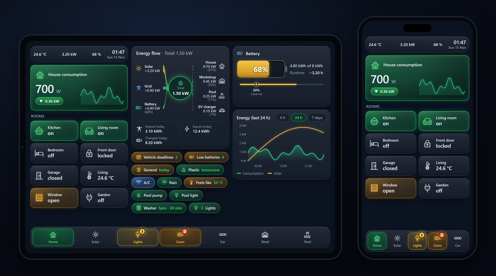
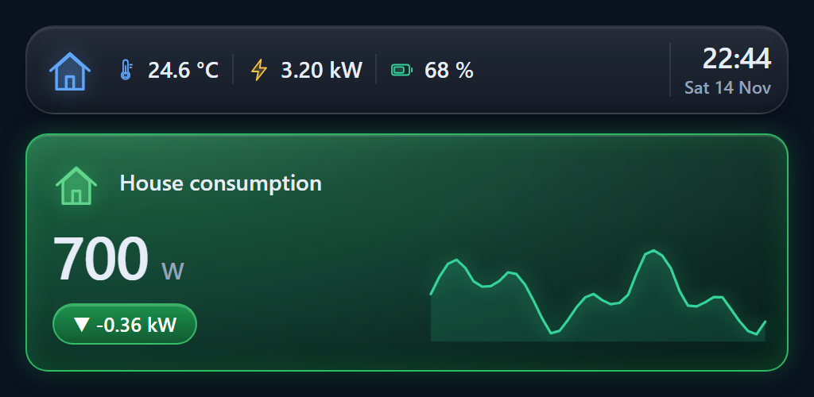
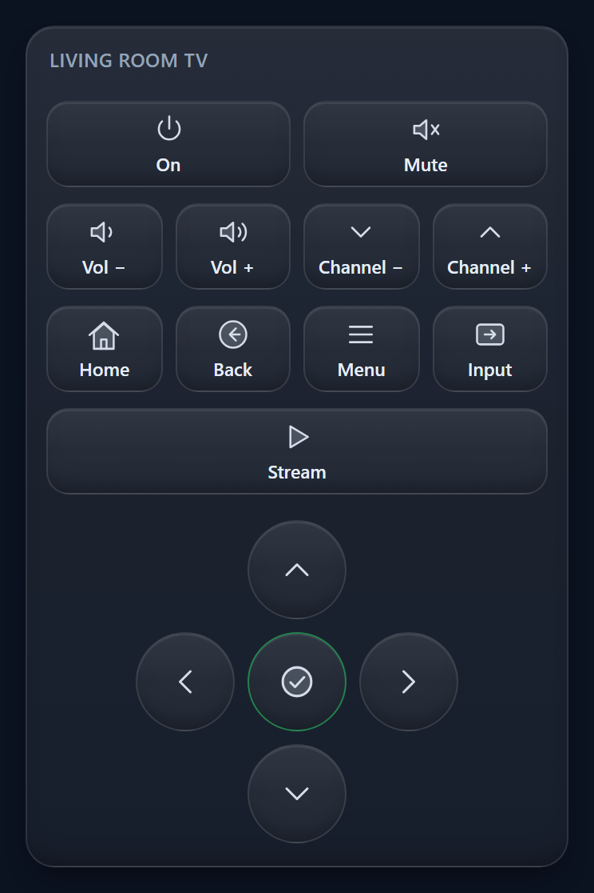
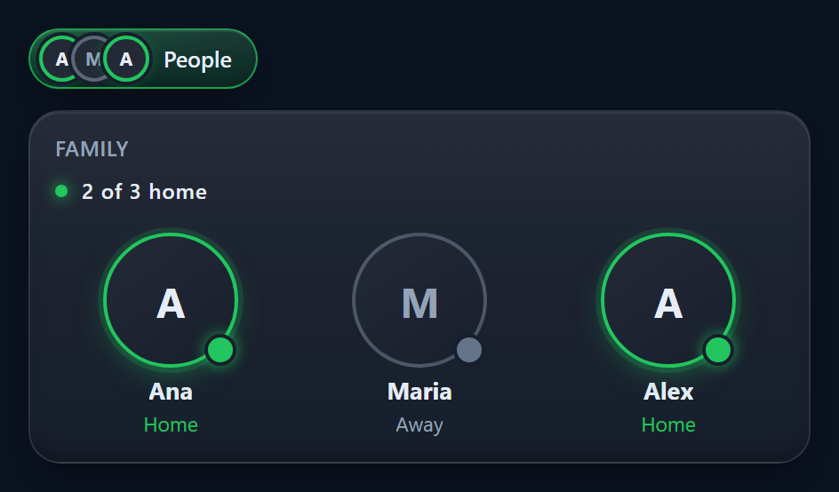
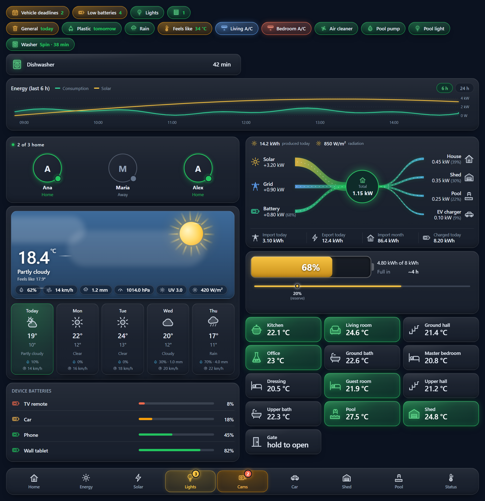
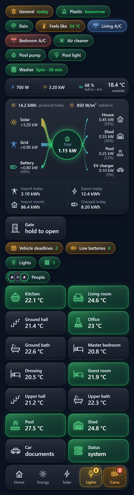
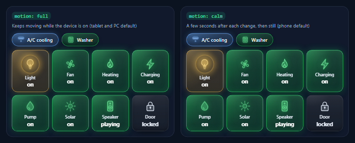

# Calm Modern UI (ccu)

Română · [English](README.md)

[](https://hacs.xyz) [](https://github.com/AdrianTIonut/ha-calm-modern-ui/releases)  [](https://github.com/AdrianTIonut/ha-calm-modern-ui/actions) 

Set de carduri pentru Home Assistant, într-un stil calm și modern: plăci sticloase, verde pentru „activ”, albastru pentru informație,
portocaliu pentru atenție. Un singur fișier JavaScript (`ccu.js`), fără rețea, fără biblioteci externe, fără `INTERNET` către terți.



| Card | Ce face |
|---|---|
| `ccu-buttons-card` | Grilă de butoane xs–xl: pastile, plăci orizontale, rând cu comutator, card „erou” cu variație și grafic mic, grupuri de alertă |
| `ccu-chips-card` | Chips cu stare (aprins / alertă / ok): apar doar când sunt active (A/C, ploaie, pompe…), stări text, calendar de colectare a gunoiului, baterii slabe, termene mașini |
| `ccu-controls-card` | Termostat / A/C cu cadran, lumini cu luminozitate, temperatură de culoare și culori rapide, ventilator, media player, număr, selector |
| `ccu-radio-card` | Player radio / muzică cu scală de acordaj, egalizator, schimbarea posturilor, volum și alegerea boxei |
| `ccu-remote-card` | Telecomandă TV (`remote.send_command`) cu D-pad, volum, canale și taste proprii |
| `ccu-flow-card` | Flux energetic: solar / rețea / baterie → consumatori, cu procente, sume, scăderi, statistici, energia produsă azi și radiația solară; puncte animate pe panglici |
| `ccu-battery-card` | Baterie cu bară, praguri (oprire / rezervă), autonomie, „Plin în” cât se încarcă și stare „Backup activ” |
| `ccu-batteries-card` | Nivelul bateriilor de la telefoane, tablete, mașini…, sortate, cu bară; le poate găsi singur |
| `ccu-graph-card` | Grafic de istoric (6 h … 30 de zile), 1–3 serii, valoare la atingere, acțiune la atingere opțională |
| `ccu-weather-card` | Vreme: valori din stația ta (Ecowitt etc.), prognoză pe 5 zile și scenă animată (ploaie, lapoviță, ninsoare, vânt, furtună, ceață, senin / noapte) |
| `ccu-people-card` | Cine e acasă: chips sau avatare mari „familie” |
| `ccu-vehicle-card` | Documente și revizii pentru mașini: RCA, ITP, rovinietă, revizie și ulei pe kilometri, cu date editabile și alerte |
| `ccu-header-card` | Antet pe un rând: iconiță, până la 3 valori (cu autonomia bateriei sub procent), ceas sau o valoare în dreapta |
| `ccu-nav-card` | Meniu de jos pentru tabletă și telefon: pagini și butoane diferite pe dispozitiv, apăsare lungă, insigne, butoane condiționate, fix jos |
| `ccu-title-card` | Titlu de secțiune cu iconiță și subtitlu |

## Noutăți în 0.10.0


- **Două teme noi:** `quiet-slate` (calmă, cu contrast verificat, fără strălucire) și `cyberpunk` (Neon Glass: indigo foarte închis, sticlă, cyan / magenta / chihlimbar / coral). Acum sunt 8 teme.
- **Opțiuni noi pe orice card** (toate oprite implicit, cu câmp în editorul vizual): `scale` și `radius` (mărime și rotunjire), `glow` (strălucire), `night` (mod noapte după soare), `font` și `font_css`, `effects` (`rim`, `mark`, `cut`, `streak`, `peak`, `plot`, `bar`, `tile`).
- **Butoane, chips și meniu:** alegi ce se vede (`show_icon`, `show_name`, `show_value`, `show_state`, `labels`), `selected: true` pe un buton, pericol separat de atenție (`danger`, `danger_above`, `danger_below`, `badge_style: danger`).
- **Valul Solar** (`wave: true` pe un buton `xl`) urmează producția de azi: curba, vârful și strălucirea vin din istoricul entității.
- **Grafic:** `icon`, `x_step` (ore rotunde din 3 în 3) și `axis_unit: false`; serii din atribut; axa de temperatură nu mai pornește de la 0.
- **Fonturi livrate** în folderul `fonts/` (Exo 2, Chakra Petch, Oxanium); descarci `fonts.zip` din ultimul release și îl dezarhivezi o dată în `/config/www/ccu/` (fișierele ajung în `/config/www/ccu/fonts/`).
- **Baterie:** capacitatea se alege din editor (`capacity_source`); „plin în” și autonomia arată minute sub o oră.
- Cardurile existente nu se schimbă fără opțiunile noi. Lista completă, cu explicații, e în [CHANGELOG.md](CHANGELOG.md).

## Galerie

<table>
<tr><td valign="top"></td><td valign="top"></td></tr>
<tr><td valign="top"></td><td valign="top"></td></tr>
<tr><td valign="top"></td><td valign="top"></td></tr>
<tr><td valign="top"></td><td valign="top"></td></tr>
<tr><td valign="top"></td><td valign="top"></td></tr>
<tr><td valign="top"></td><td valign="top"></td></tr>
<tr><td valign="top"></td><td valign="top"></td></tr>


<tr><td valign="top"></td><td valign="top"></td></tr>
</table>

## Dashboard exemplu

Un dashboard complet pe care îl poți lipi în Home Assistant: o pagină pentru **tabletă** și una pentru **telefon**, cu aceeași bară de jos pe fiecare pagină (Home duce la pagina dispozitivului pe care îl ții, iar o apăsare lungă sare la celălalt; telefonul arată 5 butoane, tableta toate 9). Toate entitățile și numele din el sunt inventate: înlocuiește-le cu ale tale. Fișier: [`examples/dashboard-calm.yaml`](examples/dashboard-calm.yaml) (modul de folosire e în primele rânduri din fișier).

<table>
<tr><td valign="top"></td><td valign="top"></td></tr>
</table>

## Iconițe animate

Iconițele se mișcă doar când are sens. **Aparatele** se mișcă doar cât sunt pornite: ventilatorul unui aparat de aer condiționat se învârte cât timp chiar răcește, tamburul mașinii de spălat se rotește, becul strălucește, centrala pâlpâie, fulgerul de încărcare, pompa sau boxa pulsează, soarele strălucește. **Iconițele de vreme** (soare, lună, nori, ploaie, ninsoare, lapoviță, grindină, furtună, ceață, vânt) se mișcă mereu. Animațiile se opresc la „reduce motion” (sau cu `animations: false`), iar `motion: calm` le păstrează scurte (vezi mai jos).


### Mișcare și baterie



Animațiile continue țin ecranul ocupat, ceea ce consumă baterie pe telefon. Fiecare card are opțiunea `motion` (și în editorul vizual, la *Aspect și limbă*):

| `motion` | Ce face |
|---|---|
| `auto` (implicit) | tabletă și PC: `full`; telefon (latura mică a ecranului sub 600 px): `calm` |
| `full` | animații continue, ca înainte |
| `calm` | aceleași animații, dar doar câteva cicluri (cam 6–10 s) după fiecare schimbare de stare, apoi static până la următoarea schimbare sau reîmprospătare. Ploaia, ninsoarea, vântul și fulgerele din cardul meteo sunt ascunse |
| `off` | nimic nu se mișcă |

```yaml
motion: full            # de ex. mișcare completă și pe telefon
weather_effects: off    # cardul meteo: auto | on | off (ploaie, ninsoare, nori)
flow_animation: auto    # cardul de flux: auto | on | off (punctele care curg pe panglici)
```

`weather_effects` și `flow_animation` urmează `motion`, dacă nu le setezi. `animations: false` oprește tot, ca înainte. „Reduce motion” din setările sistemului rămâne respectat.

## Instalare

**Cerințe:** Home Assistant cu resurse personalizate pentru dashboard (orice versiune actuală); dezvoltat și testat pe Home Assistant 2026.11. Un singur fișier JavaScript, fără dependențe, fără rețea. [Dashboardul exemplu](#dashboard-exemplu) folosește vizualizarea *Secțiuni*.

1. Copiază `ccu.js` în `config/www/ccu/ccu.js` (apare ca `/local/ccu/ccu.js`).
2. **Setări → Tablouri de bord → ⋮ → Resurse → Adaugă resursă**: URL `/local/ccu/ccu.js?v=1`, tip **Modul JavaScript**.
3. La fiecare actualizare a fișierului schimbă numărul din `?v=` (altfel browserul ține varianta veche).
4. Reîncarcă pagina (Ctrl+F5 / „Reîncarcă forțat” în aplicația mobilă).

**HACS (recomandat):** caută **Calm Modern UI** în HACS și descarcă-l, apoi reîncarcă browserul (Ctrl+F5). HACS adaugă singur resursa; `hacs.json` este inclus, iar fișierul servit e `ccu.js`.

Nu apare încă în HACS-ul tău (adăugările noi pot dura câteva zile)? Adaugă-l manual: HACS → ⋮ → **Repository-uri personalizate** → `https://github.com/adriantionut/ha-calm-modern-ui`, categoria **Dashboard**.

## Actualizare

- **HACS / Marketplace:** actualizezi **Calm Modern UI**, apoi reîncarci browserul. În aplicația de telefon: Setări → Companion app → Depanare → *Reset frontend cache* (sau închizi aplicația complet și o deschizi din nou), altfel aplicația păstrează fișierul vechi.
- **Manual:** înlocuiești `config/www/ccu/ccu.js` și schimbi numărul din `?v=` din resursă.

## Editor vizual (fără YAML)

Toate cardurile se configurează din interfața Home Assistant: **Adaugă card → Calm Modern — …** deschide un formular cu selectoare de entități și de iconițe,
liste cu ↑ ↓ ✕ și o previzualizare în direct. YAML-ul rămâne disponibil (butonul „Arată editorul de cod”), iar opțiunile pe care formularul nu le acoperă
(praguri, `show_if`, `text_map`, `on_states`…) se păstrează neatinse la salvare.

- **Flux de energie:** butonul „Detectează automat senzorii” caută senzorii de solar, contor și baterie după unitate (W / kW) și nume; bifezi doar ce ai (Solar, Rețea, Baterie).
- Textele editorului urmează limba Home Assistant (engleză sau română) și au un bloc „Aspect și limbă” (temă, limbă) pe fiecare card.
- Acțiunile (la atingere / apăsare lungă / dublă atingere) se aleg din selectorul HA și sunt înțelese direct de carduri (`perform-action`).

## Presetări și culori

Opt teme incluse (`green` e implicită; `quiet-slate` e varianta calmă, cu contrast verificat și fără strălucire; `cyberpunk` e „Neon Glass”). Orice card acceptă `preset:` și `colors:`; toate culorile fiecărei teme sunt în [docs/COLORS.md](docs/COLORS.md).


Suprascrie orice rol pe un card:


```yaml
preset: green        # implicit. Mai sunt: calm, quiet-slate, contrast, mono, warm, light
colors:              # opțional, suprascrie orice culoare
  on: '#22c55e'      # activ
  alert: '#f59e0b'   # atenție
  accent: '#3b82f6'  # informație
  cool: '#60a5fa'    # aer condiționat pe răcire
  heat: '#f4694b'    # aer condiționat pe încălzire
  series: '#34d399'  # linia graficelor
  bg: '#0b1220'      # fundal
```

Sunt acceptate doar culori valide (`#hex`, `rgb()`, `hsl()`, `var(--…)`); orice altceva e ignorat cu un avertisment pe card.

> **Capcană YAML:** `on` fără ghilimele devine `true` (și cheia `on:` devine `"true"`). Cardurile le tratează ca „on”, deci
> `colors: { on: '#22c55e' }` și `color: on` merg; ghilimelele (`"on"`) sunt totuși varianta sigură în alte câmpuri.
`animations: false` oprește toate animațiile; animațiile se opresc singure și la „reduce motion”.

### Mărime și rotunjire (pe orice card)

```yaml
scale: 1.25     # 0,7–1,6; implicit 1. Mărește / micșorează tot cardul proporțional (text, iconițe, butoane)
radius: 8       # 0–32 px; implicit 14. Rotunjirea colțurilor (0 = colțuri drepte)
```

- **`scale`** e pentru ecrane diferite (tabletă pe perete, telefon, ecran la distanță, vedere mai slabă). Când măresc, încap mai puține coloane, deci grila se reașază singură. Intervalul e 0,7–1,6; în afara lui, valoarea se aduce la limită, cu un avertisment pe card.
- **`radius`** se aplică butoanelor cu forma `chamfer` și `square`, panourilor și antetului (panourile au ~1,3× raza). Formele `round` și `pill` rămân rotunde.
- Ambele se află în editorul vizual, la „Aspect și limbă”. Fără ele, cardurile arată exact ca până acum.

### Strălucire (glow) și val luminos

```yaml
glow: soft      # auto (implicit, ca în temă) | off | soft | full — pe orice card
wave: true      # val luminos pe cardurile mari (size: xl); pe card sau pe fiecare entitate
```

- **`glow`** reglează cât strălucesc stările „pornit” / „atenție”, becurile și valul. `auto` păstrează exact ce definește tema (cele vechi strălucesc ca până acum; `quiet-slate` nu strălucește). `off` = deloc, `soft` = pe jumătate, `full` = maxim.
- **`wave`** desenează sub valoare un val subțire cu un halou discret, doar pe butoanele `xl`. Linia se vede și cu `glow: off`; haloul urmează `glow`. Se mișcă încet („respiră”) și se oprește cu `animations: false` sau la „reduce motion”.
- Becurile aprinse folosesc culorile `lamp` / `lamp-hi` din temă (în `quiet-slate` un chihlimbar discret, în rest galbenul de până acum); le poți schimba cu `colors: { lamp: '#e0bd86' }`.
- Ambele au câmpuri în editorul vizual („Aspect și limbă” și „Ce se vede pe buton”). Fără ele, cardurile arată exact ca până acum.

### Mod noapte

```yaml
night: auto          # off (implicit) | auto — întunecă cardul când soarele e sub orizont (sun.sun)
night_dim: 20        # 0–60 %, cât se întunecă; implicit 15
night_entity: binary_sensor.intunecat   # opțional: altă entitate în loc de sun.sun
```

- Fără `night`, nimic nu se schimbă. Cu `night: auto`, cardul devine mai puțin luminos noaptea (ușor, ca să nu orbească tableta pe perete) și revine singur ziua.
- Pentru o altă entitate, „on”, „night” sau „below_horizon” înseamnă noapte. Dacă entitatea lipsește, cardul rămâne ca ziua.
- Se află în editorul vizual, la „Aspect și limbă”.

### Pericol (roșu) separat de atenție

```yaml
entities:
  - entity: sensor.boiler
    alert_above: 30        # atenție (chihlimbar în quiet-slate)
    danger_above: 35       # pericol (roșu); la fel danger_below
  - entity: binary_sensor.fum
    on_as: alert
    danger: true           # alerta acestei entități se arată ca pericol
```

- Pe butoane și chips. Fără aceste chei, nimic nu se schimbă: alerta rămâne „atenție”, ca până acum.
- `danger_above` / `danger_below` trec entitatea în alertă de pericol (zero e prag valid). `danger: true` face roșie alerta pe care entitatea o avea deja.
- În meniul de jos: `badge_style: danger` face întreg elementul roșu cât timp insigna e peste 0.
- Culoarea vine din temă (`danger`, implicit roșul vechi; în `quiet-slate` un roșu pastel) și se poate schimba cu `colors: { danger: '#e88f8a' }`. În temele unde „atenția” e deja roșie (ex. `calm`), pericolul arată doar mai intens.
- Câmpuri în editorul vizual, pe fiecare buton și chip.

### Ce se vede pe chips și pe meniul de jos

```yaml
# ccu-chips-card
show_icon: true     # false = fără iconiță (pe card sau pe fiecare chip)
show_name: true     # false = doar iconița / valoarea; numele rămâne ca aria-label
# ccu-nav-card
show_icon: true     # false = doar text
labels: true        # false = doar iconițe
items:
  - { icon: home, label: Home, path: /a, show_label: false }   # suprascriere pe un element (și show_icon)
```

- Dacă ar rămâne un chip sau un buton gol (fără iconiță, nume și valoare), iconița rămâne. Insigna meniului rămâne vizibilă și fără iconiță.
- Fără aceste chei, nimic nu se schimbă. Câmpuri în editorul vizual, pe card și pe fiecare chip / buton.

### Tema `cyberpunk` (Neon Glass), fonturi și efecte

```yaml
preset: cyberpunk          # indigo foarte închis, sticlă, cyan = pornit, magenta = selectat, chihlimbar = atenție, coral = pericol
font: Exo 2                # Exo 2 | Chakra Petch | Oxanium (livrate), sau numele unui font al tău + font_css
effects: [rim, mark]       # rim | mark | cut | streak | peak | plot | bar | tile | none; gol = ca în tema aleasă
```

- **Efectele** (toate opționale, oprite în temele vechi): `rim` = contur neon cu lumină sus-stânga; `mark` = semnul „//” pe cardurile pornite și pe cele mari; `cut` = colțuri tăiate pe cardurile mari, panouri, antet și meniul de jos; `streak` = linie de lumină pe marginea de sus a cardurilor active; `peak` = diamant la vârful valului și punct alb la maximul graficului; `plot` = grafic cu linii verticale punctate (fără cele orizontale) și axa din stânga; `bar` = antetul (eticheta deasupra valorii, iconițe albe, ceas cu iconiță) și meniul de jos (iconiță lângă text, separatoare, elementul curent = pastilă luminoasă). `tile` = stilul „Neon Smart Home UI”: pe tile iconiță | separator | nume și stare, valoarea mare centrată dedesubt, „//” pe toate, iar pe cardul Solar titlu și subtitlu pe un rând și stea la vârful valului. Colțurile `cut` au 9 px, iar bordura urmează diagonala (antetul și meniul au 7 px; rândul pornit are doar colțurile stânga-sus și dreapta-jos tăiate). Tema `cyberpunk` pornește doar efectele de stil (`rim`, `mark`, `cut`, `streak`, `peak`, `plot`); formatul (mărimi, aranjare) rămâne ca la celelalte teme, deci meniul și antetul încap și pe telefon. `bar` și `tile` schimbă aranjarea (meniu pe rând, tile cu separator) și se adaugă doar cu `effects:`; cu `effects:` alegi tu.
- **Fonturile** sunt în folderul `fonts/` din depozit (Exo 2, Chakra Petch, Oxanium, toate SIL Open Font License; includ literele ă â î ș ț). Descarcă `fonts.zip` din [ultimul release](https://github.com/AdrianTIonut/ha-calm-modern-ui/releases/latest) și dezarhiveaz-o în `/config/www/ccu/`, ca fișierele să ajungă în `/config/www/ccu/fonts/` (HACS / Marketplace instalează doar `ccu.js`, niciodată fonturile; pasul e necesar și atunci). La instalarea manuală poți copia direct folderul `fonts/` din depozit. Browserul le ține apoi în cache: nu se descarcă de fiecare dată și nu se cere nimic de pe internet. Fără fișiere, textul folosește Inter / fontul sistemului.
- **Fontul tău:** pune fișierele `.woff2` și o foaie de stil cu `@font-face` în `/config/www/ccu/fonts/` și scrie `font: Numele Meu` și `font_css: /local/ccu/fonts/foaia-mea.css`. Sunt acceptate doar adrese care încep cu `/` sau `https://`.
- Graficul are și `icon:` (iconiță în titlu, cu separator în stilul `tile`), `x_step: 3` (etichete `00 03 06 …` din 3 în 3 ore, pentru intervale până la 48 h) și `axis_unit: false` (fără unitate pe axa Y: `2,0` în loc de `2 kW`), potrivit cu `plot`.
- **Valul (`wave: true`) urmează producția de azi:** curba se desenează din istoricul entității, de la începutul producției de azi până acum, cu vârful (diamant / stea, efectul `peak`) la maximul real al zilei. Strălucirea crește cu puterea de acum față de maximul zilei; fără producție azi rămâne o linie plată și stinsă, iar după apus curba zilei rămâne, dar stinsă. Fără istoric (de exemplu în editorul vizual) se arată forma decorativă.
- Pe un buton: `selected: true` îl arată „selectat” (magenta în `cyberpunk`). Alertele `danger` au textul „Alertă”.
- Câmpuri în editorul vizual: „Font” și „Efecte” la „Aspect și limbă”, „Evidențiat (selectat)” pe fiecare buton.

## Acțiuni (toate cardurile cu entități)

Pe fiecare entitate: `tap_action`, `hold_action` (500 ms), `double_tap_action` (fereastră 300 ms).

```yaml
- entity: light.living
  tap_action: toggle              # toggle | more-info | navigate | call-service | url | none
  hold_action: { action: more-info }
  double_tap_action:
    action: call-service
    service: light.turn_on
    service_data: { brightness_pct: 100 }
    target: { entity_id: light.living }
```

Implicit: lumini, prize, lacăte, jaluzele, scene → `toggle`; restul → `more-info`. Derularea paginii și mișcarea de peste 10 px anulează gestul.
`navigate` cere adresă completă (`/dashboard-x/view`); `url` acceptă doar `http:` / `https:`.

## ccu-buttons-card


```yaml
type: custom:ccu-buttons-card
columns: 2            # 1–6 (coloane pe ecran îngust)
columns_wide: 3       # coloane când cardul e lat (≥ 420 px)
density: m            # xs | s | m | l | xl (mărimea implicită)
panel: false          # true = panou cu chenar și titlu
title: Camere         # opțional
entities:
  - light.bucatarie                      # formă scurtă
  - entity: sensor.lab
    name: Lab
    icon: mdi:flask                      # merge orice iconiță din selectorul Home Assistant (mdi:…); cardul o desenează pe a lui pentru cele uzuale
    icon_color: yellow                   # green|yellow|orange|blue|cyan|red|white
    size: m
    shape: chamfer                       # chamfer | round | pill | square
    alert_above: 30                      # senzor numeric: peste prag = atenție
    secondary: { entity: sensor.lab_temp }   # text secundar: text | {attribute} | {entity} | false
    colors: { on: '#ff8800' }            # culori doar pentru această plăcuță
```

Mărimi: **xs** pastilă · **s** vertical (orizontal pe ecran lat) · **m** placă orizontală · **l** rând lat (`toggle: true` = comutator) ·
**xl** erou: valoare mare, `delta: { entity, percent_entity }`, `spark: { hours: 6 }` (grafic mic din istoric), `active: true` (verde permanent).
Puterile în W de la 1000 în sus se arată în kW (`auto_kw: false` le păstrează în W).

### Ce se vede pe buton

Fiecare buton poate arăta **iconiță, nume, linie de stare și valoare**. Le alegi pe card (pentru toate butoanele) și le poți suprascrie pe fiecare buton. Totul se setează și din editorul vizual (secțiunea „Ce se vede pe buton”; pe un buton, comutatorul „Alege ce se vede pe acest buton”).

```yaml
type: custom:ccu-buttons-card
show_icon: true        # implicit true
show_name: true        # implicit true
show_value: true       # implicit true (valoarea / textul secundar)
show_state: true       # implicit false: linia „● Pornit” / „○ Oprit”
state_style: dot       # dot = punct + text (implicit) | text = doar text
state_labels:          # opțional: alte texte pentru stări (de ex. în altă limbă)
  on: Aprins
  off: Stins
  alert: Atenție
  unavailable: Indisponibil
entities:
  - entity: light.bucatarie
    secondary: { entity: sensor.temperatura_bucatarie }   # „24,6 °C” sub starea „Pornit”
  - entity: sensor.lab
    show_state: false  # pe un buton, suprascrie cardul
```

- Cu `show_state: true` un buton are trei rânduri: **nume / stare / valoare**. Dacă ascunzi un rând, butonul se rearanjează (rămân două rânduri) și nu scade sub mărimea minimă de atingere.
- Senzorii numerici (`sensor`, `number`…) nu sunt „pornit / oprit”: la ei linia de stare apare doar pentru *Atenție*, *OK* și *Indisponibil*.
- Când ascunzi numele sau valoarea, cititoarele de ecran le primesc în continuare (`aria-label`: nume, stare, valoare).
- Fără aceste opțiuni butoanele arată exact ca până acum.

### Opțiuni pentru „alerte” și „grupuri” (pe butoane și pe chips)

```yaml
# 📹 un buton care se aprinde (atenție) când ORICARE dintre senzorii listați e „on”, cu text după număr
- entity: binary_sensor.casa_cam1_person_occupancy      # entitate de bază (obligatorie)
  name: 📹 CAMERE
  group: [binary_sensor.casa_cam1_person_occupancy, binary_sensor.hala_cam1_person_occupancy]
  group_text: Persoane pe {n} camere
  group_idle: Fără activitate

# chips care apar doar când sunt „on”, cu numărul de membri porniți dintr-un group.*
- { entity: group.all_lights, icon: mdi:lightbulb, count: true, hide_off: true }
- { entity: group.smoke_alarm, icon: mdi:fire-alert, hide_off: true, on_as: alert }   # on_as: alert = roșu/portocaliu, nu „activ”
```

## ccu-chips-card


```yaml
type: custom:ccu-chips-card
entities:
  - { entity: light.sufragerie, name: Lumini, icon: mdi:lightbulb, icon_color: yellow, show_state: true }
  - { entity: climate.ac_living, name: AC, icon: mdi:air-conditioner }   # răcire = albastru, încălzire = roșu, auto = verde; ventilatorul se învârte cât timp aparatul lucrează
```

## ccu-header-card

```yaml
type: custom:ccu-header-card
header:
  icon: home
  values:                       # maximum 3
    - { entity: sensor.temperatura, icon: thermo, color: accent, label: (medie) }
    - { entity: sensor.solar, icon: sun, color: on, label: Solar }
    - { entity: sensor.baterie_soc, icon: battery, color: ok, label: Baterie }
  right: { entity: weather.acasa, attribute: temperature, label: afară }   # în locul ceasului; fără right apare ceasul
```

Procentul bateriei poate avea dedesubt **autonomia**, ca text mic (rămâne vizibil și pe telefon):

```yaml
type: custom:ccu-header-card
header:
  icon: home
  values:
    - entity: sensor.baterie_nivel
      icon: battery
      color: ok
      runtime_load: sensor.consum_casa           # consumul, ca la cardul de baterie (+ runtime_load_entities pentru mai multe)
      runtime_capacity_kwh: 10                   # sau runtime_capacity_entity, sau runtime_capacity_ah_entity + runtime_nominal_voltage (cu runtime_capacity_source: kwh | entity | ah)
      runtime_reserve_pct: 20
      runtime_power: sensor.putere_baterie       # opțional: cât se încarcă arată „plin în …” în loc de autonomie
      runtime_charge_eta: avg                    # avg (media ultimelor 10 min, implicit) | now
      runtime_while_charging: false              # true = arată autonomia și cât se încarcă (a doua linie)
```

În editorul vizual e bifa *Arată autonomia sub valoare* de la fiecare valoare.

## ccu-nav-card

```yaml
type: custom:ccu-nav-card
items:
  - { icon: home,  label: Home,  path: /dashboard-casa/0 }
  - { icon: sun,   label: Solar, path: /dashboard-casa/solar, match: /dashboard-casa/solar }
```

**O singură bară pentru tabletă și telefon.** Același card se poate pune pe toate paginile: `Home` duce în alt loc pe fiecare dispozitiv, iar unele butoane se văd doar pe tabletă.

```yaml
type: custom:ccu-nav-card
sticky: true
items:
  - { icon: home,   label: Home,  path_tablet: /dashboard-casa/tableta, path_phone: /dashboard-casa/telefon, hold_path_phone: /dashboard-casa/tableta, hold_path_tablet: /dashboard-casa/telefon }   # apăsare lungă = saltul la Home-ul celuilalt dispozitiv
  - { icon: sun,    label: Solar, path: /dashboard-casa/solar, match: [/dashboard-casa/solar, /dashboard-casa/solar-apa] }   # se aprinde pe toate paginile grupului
  - { icon: bulb,   label: Lumini, path: /dashboard-casa/lumini }
  - { icon: camera, label: Camere, path: /dashboard-casa/camere, match: [/dashboard-casa/camere, /dashboard-casa/camere-tehnica] }
  - { icon: car,    label: Mașina, path: /dashboard-casa/masina, device: tablet }   # doar pe tabletă; `device: phone` pentru butoane doar pe telefon
```

- `path_tablet` / `path_phone` (sau `path: { tablet: …, phone: … }`) stabilesc unde duce butonul pe fiecare dispozitiv. `path` simplu e valoarea implicită.
- `hold_path` (pe orice dispozitiv), `hold_path_tablet` și `hold_path_phone` stabilesc unde duce o **apăsare lungă** (cam o jumătate de secundă): de exemplu Home de pe telefon poate sări la pagina tabletei, și invers.
- **Amplasare:** cu `sticky: true` bara stă fixă jos pe ecran și își rezervă loc în pagină. Pune cardul în **ultima secțiune** a paginii, pe toată lățimea, ca locul rezervat să fie la sfârșitul paginii; altfel ultimul rând de butoane poate ajunge sub bară.
- Telefon = ecran cu latura mică sub 600 px; restul (tabletă, iPad, PC) e tabletă. `device: phone` sau `device: tablet` pe card forțează alegerea.
- Butonul paginii curente se aprinde (verde), chiar dacă are insignă; `match` listează paginile în plus care aprind același buton.

## ccu-graph-card


```yaml
type: custom:ccu-graph-card
title: Energie (ultimele 6 h)
range: 6h                 # 6h | 12h | 24h | 7d | 30d, sau orice 48h / 3d … (1 h – 90 de zile), sau { hours: 36 }
tabs: [24h, 7d]           # file pentru schimbarea intervalului (opțional)
y_axis: right             # etichetele Y în dreapta (opțional)
height: 150
refresh_minutes: 5
series:                   # 1–3 serii; a doua cu altă unitate primește axă în dreapta
  - { entity: sensor.consum, name: Consum, color: accent, kind: area }
  - { entity: sensor.solar,  name: Solar,  color: yellow, kind: line }
```

Istoricul se cere cu `history/history_during_period` (un singur apel pentru toate seriile); fără istoric apare „fără date istorice”.

**Serii pornit / oprit** (ventile de încălzire, întrerupătoare, senzori de ușă și fereastră: stările `on`, `off`, `open`, `closed`, `home`, `not_home`…) se desenează ca **trepte**, cu *Oprit* / *Pornit* pe axă, iar ultima stare ține până acum:

```yaml
type: custom:ccu-graph-card
title: Ventil living
range: 48h
series:
  - { entity: binary_sensor.ventil_living, name: Ventil }
```

**Cronologie** (`timeline: true`): un rând pe serie, cu bară oriunde seria e pornită, până la 8 rânduri într-un card mic. Făcută pentru ventile de încălzire, întrerupătoare, uși și geamuri:

```yaml
type: custom:ccu-graph-card
title: Ventile încălzire (24 h)
timeline: true
range: 24h
series:                       # până la 8; numele e eticheta rândului
  - { entity: binary_sensor.ventil_living, name: Living }
  - { entity: binary_sensor.ventil_bucatarie, name: Bucătărie }
  - { entity: binary_sensor.ventil_dormitor, name: Dormitor, color: yellow }
```

**Atribut în loc de stare** (`attribute`): o serie poate citi un atribut numeric al entității, de exemplu temperatura unui aparat de aer condiționat (entitățile `climate` au starea `off` / `cool` / `heat`, iar temperaturile sunt atribute). `unit` e opțional (la temperaturi se folosește unitatea din Home Assistant). În editor: bifa *Citește un atribut în loc de stare*.

```yaml
type: custom:ccu-graph-card
title: AC bucătărie, real vs setat (24 h)
series:
  - { entity: climate.ac_bucatarie, attribute: current_temperature, name: Real }
  - { entity: climate.ac_bucatarie, attribute: temperature, name: Setat, color: yellow }
```

**Activ doar cât starea e…** (`state_is`): seria e „pornită” cât starea e una din valorile listate (separate prin virgulă sau listă). Împreună cu cronologia dă un rând pe modul unui termostat, cu durate și totaluri. În editor: bifa *Activ doar cât starea e…*.

```yaml
type: custom:ccu-graph-card
title: AC bucătărie, mod (24 h)
timeline: true
series:
  - { entity: climate.ac_bucatarie, state_is: cool, name: Răcire }
  - { entity: climate.ac_bucatarie, state_is: heat, name: Încălzire, color: yellow }
```

(`attribute` și `state_is` nu merg împreună pe aceeași serie. Se poate folosi orice entitate, nu doar senzori.)

Pe cronologie fiecare bară arată **cât a mers** („3 h”, „1 h 25 min”; barele înguste primesc o formă scurtă sau nimic), la marginea din dreapta apare **totalul pe rând**, perioadele în care entitatea a fost **indisponibilă** sunt **hașurate în galben**, iar axa are ore rotunde (00:00, 03:00, …). Atinge sau trece cu mouse-ul peste o bară, un gol hașurat sau o perioadă oprită ca să citești intervalul exact și durata. `hide_durations: true` scoate duratele și totalurile (bifă în editor).

O serie a cărei entitate nu are stare numerică și nici pornit / oprit nu desenează nimic (de exemplu o entitate `climate`: starea ei e modul, nu o temperatură). Folosește senzorul ei de temperatură.

## ccu-flow-card


```yaml
type: custom:ccu-flow-card
title: Flux energie
solar_today: sensor.energie_solara_azi          # opțional: energia produsă azi, rând mic sub titlu (iconiță de soare)
radiation: sensor.radiatie_solara             # opțional: radiația solară (W/m²) în același rând
sun_labels: false                             # opțional: ascunde cuvintele de lângă cele două valori (implicit se văd)
solar: sensor.solar_total_power
grid:    { entity: sensor.power_meter_active_power, invert: true }   # convenție: + = import; invert dacă senzorul tău e + la export
battery: { entity: sensor.invertor_deye_battery_power, soc: sensor.invertor_deye_battery }   # + = descărcare
consumers:                  # maximum 6; procentul e din Total (suma consumatorilor)
  - { entity: sensor.casa_consum_izolat, name: Casă, icon: mdi:home }
stats:                      # maximum 3, rândul de jos
  - { entity: sensor.import_retea_zilnic, label: Import azi, icon: mdi:transmission-tower }
```

Punctele curg pe panglici în sensul energiei (spre nod sau spre un consumator). `flow_animation: off` le oprește, iar `motion: calm` le lasă să ruleze doar câteva secunde.

## ccu-battery-card


```yaml
type: custom:ccu-battery-card
soc: sensor.invertor_deye_battery
capacity_source: ah                                      # de unde vine capacitatea: kwh | entity | ah (vezi „Capacitatea bateriei” mai jos)
capacity_ah_entity: number.invertor_deye_battery_capacity  # Ah, citiți de la inversor (sau capacity_ah: 942)
nominal_voltage: 51.2                                    # V, pentru calculul Ah × V
load: sensor.invertor_deye_load_power                    # pentru autonomie (până la rezervă, la consumul curent)
load_entities: [sensor.alt_consum]                       # opțional: alte circuite pe baterie, se adună la `load`
power: sensor.putere_baterie                             # opțional: + = descărcare, − = încărcare (power_invert: true o întoarce)
charge_eta: avg                                          # „Plin în” după: avg (media ultimelor 10 min, implicit) | now
runtime_while_charging: false                            # true = arată și autonomia cât se încarcă
grid_present: binary_sensor.invertor_deye_grid           # off = „Backup activ”; unavailable NU declanșează backup
reserve_pct: 20
shutdown_pct: 10
color: yellow                                            # yellow | green | blue | orange
```

#### Capacitatea bateriei: ce introduci

Cardul transformă procentul în kWh cu **un singur număr: energia întregii baterii la 100 %** (capacitatea nominală). **Nu** e energia rămasă după pragurile de oprire sau de rezervă: acelea le scade cardul singur. În editor, *Capacitatea bateriei vine din* are trei surse, și apar doar câmpurile celei alese:

| Sursă (`capacity_source`) | Ce dai | Când |
|---|---|---|
| **Valoare scrisă de mine** (`kwh`) | `capacity_kwh: 48.2` | cel mai simplu și mai sigur; kWh-ul nominal al bateriei |
| **Senzor în kWh** (`entity`) | `capacity_entity: sensor.…` | ai un senzor care dă kWh-ul nominal |
| **Ah × tensiune nominală** (`ah`) | `capacity_ah_entity` (senzor sau număr în Ah) sau `capacity_ah`, și `nominal_voltage` (implicit 51,2 V) | inversorul dă Ah, de exemplu Deye: 942 Ah × 51,2 V = **48,2 kWh** |

- Cu o sursă aleasă, cardul folosește **doar** acea sursă. Dacă valoarea ei lipsește (de exemplu senzorul e `unavailable`) arată „—”, nu trece pe tăcute la alt câmp. Fără `capacity_source` se poartă ca înainte: senzorul dacă are valoare, altfel `capacity_kwh`.
- **Nu folosi senzori de „estimare”.** Unele integrări publică o „capacitate a bateriei” care e o estimare învățată (de exemplu senzorul *Battery Capacity* din Solarman, care stă lângă o valoare și se calculează din contoare de energie). Nu e capacitatea scării procentuale și făcea cardul să arate cu ~20 % mai puțină energie.
- **Verifică singur:** la o încărcare de, să zicem, 30 de puncte de procent, energia intrată în baterie împărțită la 0,30 trebuie să fie apropiată de numărul introdus.
- Exemplu, 48,2 kWh cu `reserve_pct: 20` și `shutdown_pct: 10`: cu rețea banda utilizabilă e 80 % × 48,2 = **38,6 kWh** (cei 20 % de sub rezervă rămân deoparte, oprirea inclusă); fără rețea e 90 % × 48,2 = **43,4 kWh**. Oprirea de 10 % și rezerva sunt praguri pe aceeași scară 0–100 %, nu se adună.

Cum se calculează (exact, din procente și capacitate; se rotunjește doar la afișare):

- **Cu rețea**: banda utilizabilă e `reserve_pct` → 100 %. Cardul arată energia din bandă, „X kWh din Y kWh”, cu Y = (100 − rezervă)% × capacitate, și autonomia până la rezervă, la consumul curent.
- **Fără rețea (backup activ)**: banda devine `shutdown_pct` → 100 %, același „X kWh din Y kWh” și autonomia până la pragul de oprire. Doar atunci apar „Backup activ” și marcajul de oprire.
- **Autonomia** = energia utilizabilă împărțită la consumul curent (`load` plus `load_entities`, adunate), ca și cum încărcarea s-ar opri acum. Dacă vreunul dintre senzori nu are valoare, nu se afișează autonomia, în loc să iasă prea optimistă.
- **Cât timp se încarcă** (cere `power`) cardul arată „Plin în”: timpul până la 100 % la puterea de încărcare, luată ca **medie a ultimelor 10 minute**, ca cifra să nu sară când trece un nor (`charge_eta: now` folosește puterea de acum). Autonomia se ascunde cât se încarcă; `runtime_while_charging: true` o arată și pe ea. Peste 99 % „Plin în” dispare și revine autonomia. La fel în antet (`runtime_power`, `runtime_charge_eta`, `runtime_while_charging`).
- **Duratele** („Plin în” și autonomia, pe cardul de baterie și sub procent în antet) apar în **minute sub o oră** („~42 min”), în **ore și minute** până la 10 ore, rotunjite la 5 minute („~1 h 25 min”), și cu o zecimală de la 10 ore în sus („~16,2 h”).
- Schimbi `reserve_pct` (de exemplu 20 → 30) și totul se recalculează. Procentul mare e mereu starea reală de încărcare.


## ccu-batteries-card

```yaml
type: custom:ccu-batteries-card
title: Niveluri baterii dispozitive
warn_pct: 20          # sub = portocaliu
low_pct: 10           # sub = roșu
sort: asc             # crescător (implicit) sau none
entities:
  - { entity: sensor.ipad_battery_level, name: Tableta }
  - sensor.nff_battery_level
```

`auto` găsește toate dispozitivele cu senzor de baterie (`device_class: battery`), fără telefoane, tablete și browsere; `only_low: true` arată doar bateriile slabe:

```yaml
type: custom:ccu-batteries-card
title: Dispozitive pe baterii
auto: { threshold: 20, exclude: [invertor, audi], include: [sensor.alta_baterie] }
```


## ccu-people-card


```yaml
type: custom:ccu-people-card
people: [person.alex, person.maria]
label: Persoane            # false = fără etichetă
```

`layout: family` face din el cardul „Familia”: avatare mari cu nume și stare (Acasă / Plecat / zona), cu `title: Familia 👨‍👩‍👧‍👦`.

Poza vine din `entity_picture` și e acceptată doar dacă e o cale relativă la Home Assistant (`/api/image/…`, `/local/…`); altfel se arată inițialele.

## ccu-weather-card


Valorile curente (temperatură, umiditate, vânt, ploaie, presiune, UV, radiație) vin **din senzorii stației tale**, nu din prognoză;
prognoza pe zile vine din entitatea `weather.*` (serviciul `weather.get_forecasts`, tip `daily`, reîmprospătat la 30 de minute).

```yaml
type: custom:ccu-weather-card
title: Vremea
weather: weather.acasa                # pentru prognoză și pentru cerul din scenă
sensors:                              # toate opționale; un tile apare doar dacă are senzor
  temperature: sensor.gw2000a_outdoor_temperature
  feels_like: sensor.gw2000a_feels_like_temperature
  humidity: sensor.gw2000a_humidity
  wind_speed: sensor.gw2000a_wind_speed        # km/h, m/s, mph sau kn (se convertesc)
  wind_gust: sensor.gw2000a_wind_gust
  wind_direction: sensor.gw2000a_wind_direction
  rain_rate: sensor.gw2000a_rain_rate_piezo    # mm/h sau in/h
  rain_today: sensor.gw2000a_daily_rain_piezo
  rain_state: binary_sensor.gw2000a_rain_state_piezo
  pressure: sensor.gw2000a_relative_pressure
  uv: sensor.gw2000a_uv_index
  radiation: sensor.gw2000a_solar_radiation
tiles: [humidity, wind, rain, pressure, uv, radiation]   # și: lux, dew_point, feels_like, gust
days: 5                               # 1–7
hold_action: { action: navigate, navigation_path: /dashboard-casa/vreme }   # tap_action / hold_action pe scenă și pe zile
scene_fallback: true                  # când senzorii lipsesc, scena folosește starea entității weather („după prognoză”)
fallback_to_forecast: false           # true = arată și temperatura din prognoză când senzorul lipsește
```

Scena se alege din senzori: **ploaie** peste 2,5 °C, **lapoviță** între 0,5 și 2,5 °C, **ninsoare** sub 0,5 °C (intensitatea după mm/h),
**vânt** de la 12 km/h (dungi care traversează scena, picăturile se înclină), **furtună** când entitatea weather spune `lightning*`,
plus senin / parțial noros / noros / ceață, ziua sau noaptea (din `sun.sun`). Fără senzor, tile-ul arată „—”; animațiile se opresc la „reduce motion”.

## Chips: opțiuni suplimentare

```yaml
type: custom:ccu-chips-card
entities:
  - { entity: climate.ac_hala, name: A/C Hală, icon: mdi:air-conditioner, hide_off: true }          # apare doar când e pornit; dacă niciun chip nu e vizibil, tot cardul dispare (nu ocupă loc)
  - { entity: sensor.feels_like, name: Se simte, show_state: true, alert_above: 32, hide_off: true }  # apare doar peste prag
  - { entity: sensor.citire_gaz, name: Gaz, show_state: true, show_if: { attribute: days_left, min: 0, alert_at: 1 } }   # se vede doar când atributul ≥ min; alertă când ≤ alert_at
  - entity: sensor.masina_de_spalat_current_status      # stare text → „pornit”
    name: Mașină de spălat
    hide_off: true
    show_state: true
    on_states: [running, spinning, rinsing]             # ce stări înseamnă „activ” (pentru senzori text)
    text_map: { spinning: Centrifugă, running: Spală }  # traduce starea afișată
    secondary: { entity: sensor.masina_de_spalat_remaining_time }   # a doua valoare; un senzor timestamp se arată „38 min” / „gata”
waste:                                                  # chips din calendarul de colectare a gunoiului
  calendar: calendar.colectare_gunoi
  next_days: 1                                          # azi + mâine
  hide_today_after: '11:00'                             # azi se ascunde după această oră
  patterns:
    - { match: 'Gunoi: Menajer', label: Menajer, icon: mdi:trash-can, exact: true }
```

**Un singur rând, în ordinea activării.** Toate chips-urile unui card (entități, gunoi, baterii slabe, termene) stau pe un singur rând și trec pe următorul doar când nu mai încap. Cu `sort: true` (bifa *Ordonează după momentul activării* din editor) sunt ordonate după momentul în care s-au activat (`last_changed`), cel mai vechi primul. Un chip care se activează mai târziu merge la capăt, ca celelalte să nu sară. Pentru o singură linie pe tabletă, pune cardul pe toată lățimea paginii (`grid_options: { columns: full }`) și ține toate chips-urile într-**un singur** card.

```yaml
type: custom:ccu-chips-card
sort: true
```

**Chips inactive în editor.** Cât editezi cardul (editorul cardului sau modul de editare al dashboardului), chips-urile ascunse acum (`hide_off`, `show_if`) apar estompate, cu chenar punctat, ca să vezi tot ce poate arăta cardul. Pe dashboard rămân ascunse.

Chip **baterii slabe**, care găsește singur dispozitivele pe baterii (senzori de baterie; telefoanele și tabletele sunt lăsate deoparte):

```yaml
type: custom:ccu-chips-card
low_batteries:
  threshold: 20                 # slabă = până la acest procent (implicit 20)
  exclude: [invertor, audi]     # cuvinte din nume / entity_id care se exclud
  tap_action: { action: navigate, navigation_path: /dashboard-casa/baterii }   # implicit: more-info pe cea mai slabă
```

Apare doar când ceva e slab: numărul („Baterii slabe 3”) sau, dacă e una singură, numele și nivelul ei.


Pe butoane, `text_map` traduce textul stării (când nu e dat `secondary`).

## ccu-nav-card — opțiuni suplimentare

```yaml
type: custom:ccu-nav-card
sticky: true          # fix pe ecran cât derulezi; un spațiu gol rezervă locul (spacer: false îl scoate)
compact: true         # capsulă îngustă, centrată (în loc de bară pe toată lățimea)
labels: false         # doar iconițe, fără nume
items:
  - { back: true, icon: back, label: Înapoi }                                          # history.back
  - { icon: tablet, label: Tableta, path: /dashboard-casa/calm, visible_if: { entity: sensor.browser_user, state: Tableta } }   # se vede doar când starea se potrivește
  - { icon: camera, label: Cam, path: /dashboard-casa/camere, badge: [binary_sensor.cam1_person, binary_sensor.cam2_person] }  # insignă cu câte entități sunt „on”; butonul devine portocaliu

  - { icon: bulb, label: Lumini, path: /light, badge: [sensor.becuri_aprinse], badge_style: light }   # insignă galbenă cu numărul de becuri aprinse (un senzor numeric adaugă valoarea lui)
```

## ccu-graph-card — opțiuni suplimentare

`height: 60–400` (înălțimea graficului); `compact: true` urcă legenda în rândul titlului, deci cardul e mai scund. Etichetele axei Y se lățesc după cea mai lungă etichetă (ex. „2 000 ppb”).

## ccu-flow-card — opțiuni suplimentare

```yaml
consumers:
  - { entity: sensor.casa_consum_izolat, subtract: [sensor.piscina_total_power], name: Casă, icon: mdi:home }      # valoarea minus alte entități (minim 0)
  - { entities: [sensor.hala_a, sensor.hala_b, sensor.hala_c], subtract: [sensor.ev_power], name: Hală }          # suma mai multor entități (ex. 3 faze)
  - { entity: sensor.piscina_total_power, name: Piscină, hide_idle: false }                                        # hide_idle (implicit true): sub 10 W consumatorul nu se desenează
grid: { entity: sensor.power_meter_active_power, invert: true, above: [{ entity: sensor.import_lunar, label: lună }], below: [{ entity: sensor.import_zi, label: azi, arrow: in }] }   # valori mici deasupra / sub valoarea nodului
```

Semne afișate: rețea — export „+”, import „−”; baterie — încărcare „+”, descărcare „−”. Coloanele de text au lățimea textului, deci panglicile pornesc lângă valori.

## ccu-battery-card — `show_title: false`

Scoate titlul „Baterie” cu iconiță (mesajul „Backup activ” rămâne).

## ccu-people-card — `layout: family`

```yaml
type: custom:ccu-people-card
layout: family        # avatare mari cu nume și stare; se micșorează după lățimea cardului
people: [person.ana, person.maria, person.alex]
summary: false        # (implicit true) scoate linia „2 din 3 acasă”
```

## ccu-title-card

```yaml
type: custom:ccu-title-card
title: Bucătărie
subtitle: Climă · lumini
icon: pot
```

## ccu-controls-card


Controale pentru ce nu se rezolvă cu o atingere: termostat, lumină cu luminozitate, ventilator, media player, slider de număr și selector. `kind` se deduce din domeniu.

```yaml
type: custom:ccu-controls-card
title: Climatizare      # opțional
columns: 1              # 1–3
items:
  - { entity: climate.a_c_casa, name: A/C casă }              # cadran: țintă mare, +/−, moduri, ventilator / oscilare / preset (dacă aparatul le are); style: simple = varianta compactă
  - { entity: light.scafa_rgb, name: Scafă RGB }              # buton rotund pornit/oprit + slider de luminozitate; un bec doar on/off devine plăcuță simplă fără slider
  - { entity: fan.recuperator, labels: { night: Noapte } }    # viteză pe slider (pe pasul aparatului) + preseturi
  - { entity: media_player.tv }                               # titlu, transport, mute, volum (slider sau +/− după aparat)
  - { entity: number.timer, name: Temporizator }              # slider cu min / max / pas din entitate
  - { entity: select.program, name: Program, labels: { eco: Eco } }   # select nativ
```

Atingerea titlului aprinde/stinge; apăsarea lungă nu e necesară (butonul rotund face același lucru). Valorile trimise rămân afișate „optimist” ~3 s, până revine starea din HA.

## ccu-vehicle-card


Termene pe mașină (RCA, ITP, rovinietă, revizie / ulei): zile rămase, bară care devine portocalie cu `alert_days` zile înainte și roșie după dată, iar datele se schimbă chiar din card.

```yaml
type: custom:ccu-vehicle-card
alert_days: 3
vehicles:
  - name: Audi A3
    plate: B 00 XYZ
    documents:
      - { label: RCA, entity: input_datetime.audi_rca }              # un helper „dată”: atingi rândul și alegi data nouă
      - { label: Revizie, entity: sensor.audi_service_date }          # senzor cu dată: doar afișare
      - { label: Ulei, odometer: sensor.audi_odometer, last_km: input_number.audi_ulei_km, interval_km: 10000 }   # butonul „Schimbat acum” pune kilometrajul curent
```

Chip pe cardul de chips-uri: `deadlines: { alert_days: 3, vehicles: [...], tap_action: {...} }`; apare doar cât timp ceva se apropie sau a expirat.

## ccu-radio-card


```yaml
type: custom:ccu-radio-card
title: Radio piscină
stations: input_select.radio_favorite       # opțiuni de forma „Nume - https://adresa-stream”; adresa nu se vede
player: media_player.boxa_piscina           # boxa principală: volum și disponibilitate
speakers:                                   # opțional: mai multe boxe, cu butoane pentru alegerea celei pe care cântă
  - media_player.boxa_piscina
  - media_player.boxa_living
playing: input_boolean.radio_porneste       # opțional
play: script.radio_play                     # opțional: scripturile tale; fără ele cardul trimite adresa stream-ului boxei alese
stop: script.radio_stop
hide: [Custom]                              # ascunde posturile care conțin aceste cuvinte
```

## ccu-remote-card


```yaml
type: custom:ccu-remote-card
entity: remote.living_room_tv        # remote.send_command
dpad: true                           # crucea cu OK (false = fără)
commands: { power: KEY_POWER, volu: KEY_VOLUP }   # redenumește comenzile (alt model de TV)
rows: [[power, mute], [vold, volu, chd, chu]]     # ce taste apar și în ce ordine: power mute vold volu chd chu home back menu input
extra:                                # taste proprii
  - { label: Netflix, icon: play, command: KEY_11 }
```

Volumul și canalele se repetă cât ții apăsat.

## Depanare

- **„Custom element doesn't exist: ccu-…”**: resursa nu e încărcată. Verifică Setări → Dashboard-uri → ⋮ → Resurse (tip *Modul JavaScript*, adresa `/local/ccu/ccu.js?v=…`), apoi reîmprospătare forțată (Ctrl+F5; în aplicație: *Reset frontend cache*).
- **O opțiune nouă nu face nimic după o actualizare**: browserul sau aplicația au încă fișierul vechi. Schimbă numărul `?v=` din resursă și reîmprospătează forțat.
- **Un card arată „—”**: entitatea nu există sau nu are încă o valoare. Copiază id-ul exact din Instrumente pentru dezvoltatori → Stări.
- **Autonomia bateriei arată „—”**: are nevoie de senzorul de consum (`load`, în W sau kW). La `load_entities`, fiecare senzor din listă trebuie să aibă valoare.
- **„Plin în” lipsește cât se încarcă**: are nevoie de senzorul de putere al bateriei (`power`: + = descărcare, − = încărcare; `power_invert: true` îl întoarce) și de un nivel sub 99 %.
- **Ultimele butoane ale unei pagini sunt acoperite de bara de jos**: pune bara în ultima secțiune de pe toată lățimea a paginii (vezi cardul de meniu).
- **Telefonul se descarcă mai repede cu dashboardul deschis**: animațiile țin ecranul ocupat; ajută `motion: calm` (implicit pe telefon) sau `motion: off` (vezi *Mișcare și baterie*).
- **Home trebuie să ducă în alt loc pe telefon și pe tabletă**: folosește `path_tablet` / `path_phone` pe acel buton.

## ccu-radio-card


Player de muzică / radio: ecran cu echalizator, scală de acordaj cu ac, post anterior / următor, play / stop, volum și alegerea boxei.

```yaml
type: custom:ccu-radio-card
title: Radio piscină
stations: input_select.radio_favorite       # opțiuni de forma "Nume - https://adresa" (adresa se ascunde)
player: media_player.boxa_piscina           # boxa principală: volum + disponibilitate
speakers:                                   # opțional: mai multe boxe, cu butoane de alegere
  - media_player.boxa_piscina
  - media_player.boxa_living
playing: input_boolean.radio_playing        # opțional
play: script.radio_play                     # opțional: scripturile tale; fără ele cardul trimite adresa postului boxei alese
stop: script.radio_stop
hide: [Personalizat]                        # ascunde posturile care conțin aceste cuvinte
```

## Limbi (i18n)

Cardurile vorbesc limba lui Home Assistant (`hass.locale.language`): **engleză** și **română** sunt incluse; orice altă limbă cade pe engleză.
Poți fixa limba pe un card cu `language: ro` (sau `en`). Se traduc: stările, etichetele, modurile, zilele și lunile, avertismentele de configurare, textele de pe carduri; numerele folosesc separatorii limbii (ro: `1 234,5`; en: `1,234.5`).

```yaml
type: custom:ccu-controls-card
language: ro        # opțional; implicit limba din profilul HA
items: [climate.living]
```

Adaugi o limbă nouă fără să atingi restul codului: în `src/i18n.mjs`, în obiectul `DICT`, un dicționar cu cheia fraza românească (limba sursă) și valoarea traducerii; ce lipsește cade pe engleză.
`tests/i18n.test.mjs` verifică automat că orice `t('…')` din cod are traducere în engleză.

## Iconițe

Setul propriu (`src/icons.mjs`) are cheile: bulb, fan, flame, door, lock, camera, thermo, bolt, home, sun, plug, speaker, blinds, battery, ac, snow, wifi, sofa, bed, flask, stairs, pool, pot, car, audi, pylon, bath, warehouse, washer, drop, gauge, compass, trash, recycle, paper,
back, tablet, play, stop, clock, cog, counter, leaf, power, mute, volup, voldown, menu, input, up, down, left, right, ok, prev, next, pause, tv, chart, wave, calendar, bell, wrench, refresh, download, upload, cash, chip, database, globe, server, robot, mower, filter, sliders, radio, swaph, swapv, weight, ruler, alert, info, shield, sunset, hand, w-* (vreme).
Numele `mdi:…` sunt mapate la ele (sute de aliasuri); un `mdi:` necunoscut cade pe iconița domeniului entității.


## Dezvoltare

Sursele sunt în `src/*.mjs` (module ES, scrise ca funcții pure acolo unde se poate); `ccu.js` se generează.

```bash
node build.mjs                        # produce ccu.js (fiecare modul în funcția lui, fără dependențe)
node tests/run-all.mjs                # toate testele (render, config, state, actions, gestures, icons-presets, graph-card, graph-data, energy, weather, controls)
```

Reguli de proiect: fără rețea și fără biblioteci; DOM actualizat pe loc (fără a-l reface la fiecare schimbare); orice text din config trece prin escapare;
orice valoare lipsă devine „—”, niciodată `NaN`/`undefined`.

Licență: MIT.
