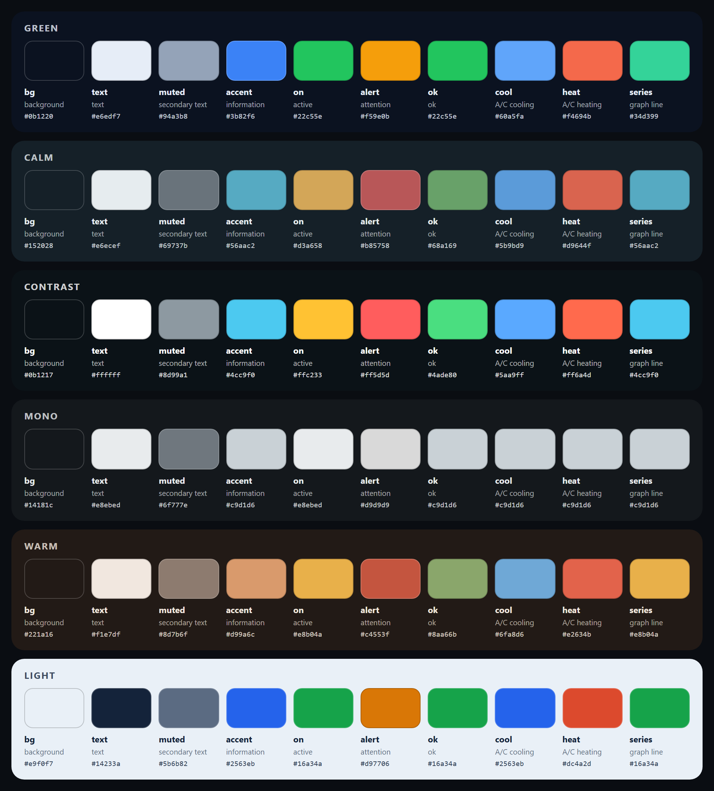

# Colors

Every card accepts `preset:` (`green`, `calm`, `quiet-slate`, `contrast`, `mono`, `warm`, `light`) and `colors:` to override any role (see the README).

| Role | green | calm | quiet-slate | contrast | mono | warm | light |
|---|---|---|---|---|---|---|---|
| `bg` — background | `#0b1220` | `#152028` | `#171d25` | `#0b1217` | `#14181c` | `#221a16` | `#e9f0f7` |
| `text` — text | `#e6edf7` | `#e6ecef` | `#e5eaf0` | `#ffffff` | `#e8ebed` | `#f1e7df` | `#14233a` |
| `muted` — secondary text | `#94a3b8` | `#69737b` | `#b8c5d2` | `#8d99a1` | `#6f777e` | `#8d7b6f` | `#5b6b82` |
| `accent` — information | `#3b82f6` | `#56aac2` | `#a5bfe2` | `#4cc9f0` | `#c9d1d6` | `#d99a6c` | `#2563eb` |
| `on` — active | `#22c55e` | `#d3a658` | `#9bcbb6` | `#ffc233` | `#e8ebed` | `#e8b04a` | `#16a34a` |
| `alert` — attention | `#f59e0b` | `#b85758` | `#e0bd86` | `#ff5d5d` | `#d9d9d9` | `#c4553f` | `#d97706` |
| `ok` — ok | `#22c55e` | `#68a169` | `#9bcbb6` | `#4ade80` | `#c9d1d6` | `#8aa66b` | `#16a34a` |
| `cool` — A/C cooling | `#60a5fa` | `#5b9bd9` | `#a5bfe2` | `#5aa9ff` | `#c9d1d6` | `#6fa8d6` | `#2563eb` |
| `heat` — A/C heating | `#f4694b` | `#d9644f` | `#e3a4a4` | `#ff6a4d` | `#c9d1d6` | `#e2634b` | `#dc4a2d` |
| `series` — graph line | `#34d399` | `#56aac2` | `#84bceb` | `#4cc9f0` | `#c9d1d6` | `#e8b04a` | `#16a34a` |

Valid values for `colors:` are `#hex`, `rgb()`, `hsl()` and `var(--…)`; anything else is ignored with a warning on the card.

## quiet-slate

A calm, low-glare blue-grey theme (contrast checked: main text on every surface ≥ 7:1, accents ≥ 4.5:1; the test is `tests/contrast.test.mjs`).
Neutral surfaces `#171d25` / `#202833` / `#27313d`; muted pastel accents; **no outer glow** and a discreet state tint.
It adds no new options to your cards: pick it with `preset: quiet-slate` (or in the visual editor). The existing themes are unchanged.

`quiet-slate` also defines the “selected” look of the bottom menu and graph tabs: `sel-bg` (teal gradient `#2a5551` → `#264651`), `sel-line: #7fb8b2`, `sel-fg: #eaf4f1`. Other themes keep their old selected look (the “on” colors).

`quiet-slate` defines `danger: #e88f8a` (a pastel red, clearly different from the amber “attention”), used by the optional danger alerts. Other themes use the old red.

`cyberpunk` (Neon Glass), measured on the reference image “Neon Smart Home UI Dashboard-1” (mean left / right colour of every element, compared with `stylex.py`): background `#0a0c17`, cards `#1b1f35`, text `#d9daf7`, secondary `#9197c6`, on / accent `#5bb7c9` (cyan; tile fill `#1a343e`), selected `#e0a6dc` outline (tile fill `#43274d`, menu pill `#613f71 → #523865`), attention `#e1bb5b` (tile fill `#342e2a`), danger `#ca6d7c` (tile fill `#332432`), graph `#9197c6`. Contrast is checked in `tests/contrast.test.mjs`.

`quiet-slate` also sets the bulb (“lamp”) colors: `lamp: #e0bd86`, `lamp-hi: #efd7a6` (a discreet amber). Other themes keep the usual yellow. Both keys can be overridden under `colors:`.
